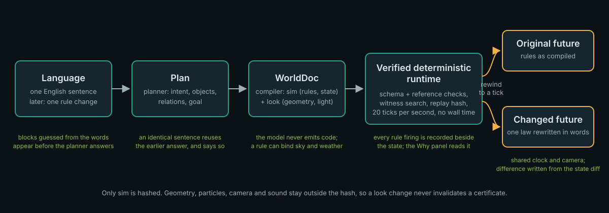

# WORLDSTREAM PLAY – Imagine a game. Play it.

Write one sentence and get a short 3D game you can play right away by tapping where to go. When you win or lose, change one thing ("Make it harder"), get a new game that remembers where it came from, and send the link to a friend – no account, no install.

**Try it at `/play`** on a running build (see Quick start). Every game has its own link, `/play/<id>`; links stay for 180 days, and every remix points back to its parent.

## How it works

```
sentence ─► Director ─► GameSpec ─► Compiler ─► WorldDoc blueprint ─► deterministic runtime
            (model)     (~1–2 kB)   (deterministic,     (world + geometry + objects)
                                     milliseconds)
                                        │
                                        └─► Verifier: keypoints + winning witness + replay ─► QualityReport
GameVersion = hash(spec, world, seed, schema/compiler/runtime versions, parent)
```

- **Instant draft, better version later.** A deterministic draft built from the words of the sentence is compiled, verified and published at once; the model-written version replaces it when it is ready ("Your custom version is ready"), without breaking the link.
- **The model writes only a GameSpec** – archetype, mechanics from a closed registry, roles and a goal. It never writes code, rules or geometry. The compiler turns the spec into the world the runtime below already runs.
- **Nothing unwinnable is published.** The verifier proves each keypoint of the goal over the real runtime, finds a winning path and replays it to an equal state hash; a game that fails any of these is refused with its reason.
- **Versions never change.** The id is a hash of everything the game stands on; publishing the same game twice returns the same id, and a remix is a new version whose parent stays as it was.

Measured numbers and verdicts for every release gate are in [docs/play/GATES.md](docs/play/GATES.md). In short: all 40 golden sentences give a publishable draft (median 53.6 ms on the server from sentence to verified game); the model-written version took a median of 40.4 s in one live run of 8 sentences.

## Under the hood – the WORLDSTREAM world compiler

PLAY stands on the world compiler this repository started as: describe a place in one sentence, act inside the world it compiles to, rewind, change one of its laws in words, and compare two synchronized futures side by side.

The sentence never becomes code. A planner turns it into a plan, a compiler turns the plan into a **WorldDoc** (declarative rules, state and geometry), and a hand-written deterministic runtime checks that document, searches for a winning path, and runs it at 20 ticks per second with no real-world time in the hashed state. Because the runtime is deterministic, the same world can be rewound to any tick and re-run under a rewritten rule, and the two runs stay comparable to the tick.

**Current delivery runs on the author's machine only.** [Watch the 90-second live A4 video](videos/worldstream-a4/worldstream-a4-live.mp4) or follow the [judge runbook](docs/demo/judge-runbook.md). Public operation, independent human review and the product acceptance gates are still open; the numbers below say exactly how far it got.

## Quick start

```powershell
npm ci
npx playwright install chromium
npm run build
npm run start
```

Use the production build; Next dev is not acceptance evidence. Live generation additionally needs the server-side model transport and spend controls (`WORLDSMITH_BRANCH=live`, `WORLDSMITH_MODEL_ENDPOINT`, `WORLDSMITH_MODEL_KEY`, `WORLDSMITH_SPEND_CAP_USD`); the commands above do not configure that service. The [demo walkthrough](docs/submission/demo-walkthrough.md) lists the exact sentences used in the recorded run.

What you do on the page, in order:

1. **Generate my world** is the default. Type your own sentence. Rough masses guessed from the words in the sentence appear before the planner answers, labelled as guesses; the planner's own preview replaces them. The same sentence typed again reuses the model's earlier answer and says so on screen.
2. Once the world is accepted, perform an available action (a lever, a terminal, a door). Every tick in which a rule fired gets a **Why?** marker on the time axis; clicking one opens the Why panel: the visitor input at that tick, which rules fired, which condition held or did not, what each rule wrote, and what read those values within the next 20 ticks.
3. **Before my last action** rewinds to the tick before your input. Write one change to an existing rule in plain words. The model proposes the change, the runtime validates it, and you see the proposal before confirming.
4. After confirming, both futures run from the fork tick with the same inputs, shared time and camera. A sentence written from the state diff (not by the model) says when the futures first part and which values differ most. Each accepted change stays in a list, so you can switch between up to six futures and compare any of them against the original.

**Prepared demo** is a separate, explicitly labelled choice. A failed or unavailable live generation reports its reason; it never substitutes a prepared world in the background.

## Architecture of the world compiler



- **Language → Plan.** `src/model/worldstream-prompt.ts` asks the planner for intent, objects, relations and goal. While it works, `src/scene/word-massing.ts` builds a model-free massing layout from a closed dictionary of about 150 object nouns; 0.951 of the 120-sentence judge corpus gets at least one mass.
- **Plan → WorldDoc.** The compiler emits a `worldstream-v2` blueprint: `sim` (topology, entities, rules, state, witness) inside the state hash, `look` (geometry, palette, light, atmosphere) outside it. A rule can bind a world variable to a look preset (`src/worldstream/look.ts`: day, dusk, night, storm, fog), so a rule can darken the sky or start a storm without touching the hashed state.
- **Verified deterministic runtime.** `src/worldstream/schema.ts` and `references.ts` reject a document that points at nothing; `src/verify` searches for a winning witness and replays it against the hash; `src/sim` runs it. Since P22 each rule firing is recorded beside the state (`StepResult.explain`), which is what the Why panel reads.
- **Two futures.** `src/worldstream/branch-controller.ts` forks the runtime at a tick, `comparison-narration.ts` writes the difference sentence from the two snapshots, and `FutureViews.tsx` keeps the accepted futures. A confirmed change is committed as `comparison-only` with no new winning certificate.
- **Geometry.** 30 first-party models under `public/assets/worldstream/` (two levels of detail each, provenance in `PROVENANCE.md` there), parametric architecture and terrain, and SDF shapes meshed in a Web Worker for forms the catalog does not have.
- **Answer cache.** `src/server/answer-cache.ts` keys on the sentence, the stage and the model effort; a hit is announced on screen as a reused answer.

## Known limitations of the world compiler

All numbers are single measurements on the dates given, not percentiles or guarantees.

- **Latency.** One live run on 19 September 2026 (`gpt-6-astra`, planner at low effort, two sentences): planner median **59.9 s**, compiler median **164 s** per call. One of the two sentences reached a playable world after 425 s and three model calls; the other failed the layout check after three rounds. The one recorded browser run of 17 September took **258.445 s** from sentence to a controllable world and **8.555 s** for the rewind-change-compare path. The P20 target (a working world at p95 within 90 s, a recognisable layout within 45 s) is not met.
- **Authored geometry.** Replaying the archived 30-sentence run on 18 September: the model's own hero geometry passed the mesh gate for **20 of 30** sentences; 6 of the rest exhausted the witness search, 2 had no usable answer. Five of the 20 (c01, c03, c08, c12, c30) depend on a time budget and move between machines.
- **Second sentence.** The gate for adding an object or changing a rule in a running world (`A10`) accepted **2 of 3** attempts on 19 September at a median of 30.6 s; the run before it accepted 1 of 4. Rejections are shown with their reason; the runtime accepts only bounded compatible edits of an existing condition, action or timer and refuses structural changes.
- **Catalog coverage.** The 30 models cover 0.446 of the object-kind demand in the judge corpus, weighted by how often a kind is asked for (0.12 before the 24 models added in P22). Everything else is SDF or parametric, and schematic.
- **What a green check does not prove.** Schema validity, a found witness and an equal replay hash certify consistency and winnability, never that the world means what the sentence meant or looks convincing. Search exhaustion is not proof that a world cannot be won.
- **Operation.** The repository URL in `submission.json` returned 404 at the last check, the hosted demo depends on a temporary tunnel to the model, and no person outside the project has evaluated the product. Hand-authored `/dev/reference-scenes` are renderer calibration fixtures, never hidden generation fallbacks.

## Checks and attribution

```powershell
npm run typecheck
npm run test
npm run test:e2e
node scripts/submission-check.mjs
```

Use targeted suites for changed behavior. Windows graphics tests record the actual hardware renderer; software-rendered CI and hardware timings are distinct. Third-party materials are documented in [DISCLOSURE.md](DISCLOSURE.md), generated from `disclosure.json`; the video composition's own dependencies are listed separately in [its asset manifest](videos/worldstream-a4/third-party-assets.json).

Measurement artefacts referenced above: [latency-p21.json](evals/worldstream/latency-p21.json) (planner and compiler), [create-replay.json](evals/worldstream/create-replay.json) (authored geometry), [conversation.json](evals/worldstream/conversation.json) (A10 gate), [asset-demand.json](evals/worldstream/gauntlet/asset-demand.json) and [word-massing.json](evals/worldstream/gauntlet/word-massing.json) (judge corpus). The 13 September figures in [latency-report.json](evals/worldstream/latency-report.json) and [create-report.json](evals/worldstream/create-report.json) concern an earlier compiler and are kept for provenance only.
