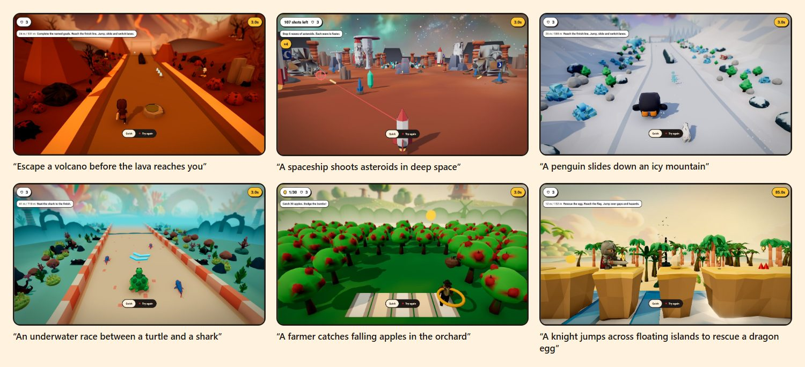
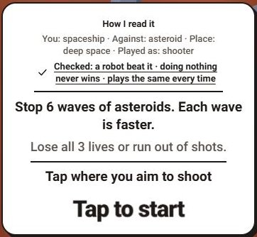

# Sayplay – Say it. Play it.

Type one sentence and play a 3D game made from it, with its own rules, goal and win check, in the browser in a median 1.8 s. No account, no install.

**Live demo:** [worldstream-sigma.vercel.app](https://worldstream-sigma.vercel.app) · **Video:** linked here with the submission · **Every number below links to its measurement:** [evals/play/p79/claims.md](evals/play/p79/claims.md)



## Try it in 30 seconds

Open the demo, type a sentence, press **Make it!**, play with arrow keys or touch.

1. `A penguin slides down an icy mountain` – a downhill runner: dodge, jump, reach the finish.
2. `A spaceship shoots asteroids in deep space` – a shooter against the asteroids.
3. `Explain how volcanoes erupt to a ten year old` – not a game idea at all. It still becomes a playable game; this is what the system does with sentences outside its category.

Then win, press **Dare a friend to beat it**, and open the link in a private window: the second player races your run.

## What is new here

A sentence becomes a **game with rules**, not a scene to look at. Every published game has a goal, a way to lose, and a proof that it can be won: before anyone sees it, a robot player wins it, an idle player fails to win it, and two replays of the robot's run end in the same state hash.



- **Two versions of every idea.** A quick version is built from the words on the server and is playable in a median 1.8 s. In the background an AI director reads the same sentence and returns a richer GameSpec (controls, add-ons, look, setting, roles, goal); it goes through the same compiler and the same robot check and arrives as a new game linked to the quick one.
- **The card before the start says what the game understood.** "You: spaceship · Against: asteroid · Place: deep space · Played as: shooter", and which checks it passed (right).
- **28 kinds of play** from one closed registry: runner, platform, flap, steer, free movement, shooter, throw, timing, rhythm, duel, glide, mini golf, a shooting gallery, a shop shift, sorting, merging, catching and more.
- **Dare, remix, feed.** A dare link replays the winner's run as a ghost ([Ghost.tsx](src/components/play/arcade/Ghost.tsx)); on the deployed demo a dare sent from one browser opened in a second one for 56/56 games ([live.md](evals/play/p74/live.md)). The server replays every dare run before its score counts. A remix chip ("Make it harder", "Swap the enemy") or a remix sentence makes a new game with a link back to its parent; the original never changes. The feed shows games one per screen.
- **Show me how** in the pause menu replays the robot's winning run inside the game ([session.ts](src/components/play/arcade/session.ts)).

<br clear="right">

## How it meets the brief

| Hackathon mandate | How Sayplay does it | Proof |
|---|---|---|
| Runs fully in the browser, no install | Next.js and three.js; a game is a link that opens on desktop and phone | Game link to first frame: median 1.4 s on an emulated iPhone 15, 2.6 s on an emulated Pixel 7, 56/56 games played through ([live.md](evals/play/p74/live.md)) |
| Natural language → 3D scene **and working logic** | The sentence becomes a GameSpec; a compiler turns it into a world with rules, goal and loss; a robot must win it before it is published | Held-out set of 200 sentences: 200/200 playable, the robot won 200/200, an idle player lost 199/200 ([run file](evals/play/p74/run-2026-11-07.json)) |
| Survives judges' own prompts, including prompts outside the focus area | No scripted demo: every game is compiled from the sentence; a verb it does not know becomes the nearest game it can build | 48/48 sentences that are not game ideas ("a tax audit", "summarize the French revolution") became playable games ([run file](evals/play/p74/run-2026-11-07.json), [set](evals/play/p30/README.md)). On the deployed demo, 56 of 60 hostile sentences (other languages, nonsense, emoji only, violence, brand names, prompt injection) became games the robot won and 4 got a clear message, with 0 crashes or blank screens; the five defects that run found are fixed ([hostile.md](evals/play/p78/hostile.md)) |
| Backend live during judging | Serverless API on the demo host, durable game store, spend caps so traffic cannot exhaust the budget | 20 visitors at once: 20/20 got a game, p95 8.6 s to an open game ([load.md](evals/play/p78/load.md)). A scheduled probe checks the demo and `/api/health` every 10 minutes and opens an issue on failure ([health-probe.yml](.github/workflows/health-probe.yml)). Games are kept 180 days ([store.ts](src/play/version/store.ts)); the demo stays online until at least 31 December 2026 |

Focus category: **Browser-native creative tools**.

## How it works

```
sentence ─► word draft ─► GameSpec ─► compiler ─► world + rules ─► robot check ─► published version (hash id)
                │                                                                       │
                └─► AI director (background) ─► GameSpec ─► same compiler + robot check ┴─► child version ─► feed
```

### Why we built it this way

**1. A closed registry instead of generated code.** The model writes only a GameSpec – choices from a fixed registry of controls, add-ons, looks and roles, plus a title and a goal line, 1–3.5 kB ([director.md](docs/play/director.md), [registry](src/play/spec.ts)). Its answer is validated against a strict schema ([answer-schema.ts](src/play/director/answer-schema.ts)) and it never writes code, rules or geometry. That gives three things at once: no model output is ever executed, every answer compiles into something playable, and the answer is short enough to be cheap. The cost of the choice: a sentence can only use mechanics the registry has, so an unusual verb becomes the closest game rather than a new mechanic.

**2. Two layers: instant and AI.** The quick version needs no model, so the player is never blocked by one: median 1.8 s from a new sentence to a playable game on the deployed demo ([ai.json](evals/play/p74/ai.json)). The AI version takes longer – median 56.7 s on the production model, gpt-6-astra through the paid OpenAI API with no fallback model, in the last full run ([director.json](evals/play/p58b/director.json)) – and when it is ready the page says "Full-detail version ready" with a **Play it** button ([UpgradeBanner.tsx](src/components/play/UpgradeBanner.tsx)). If the AI is down or over its cap, the game stays the quick version and the page says so.

**3. Determinism and a robot gate.** Arcade games step at a fixed 60 Hz with seeded random streams ([contract.ts](src/play/arcade/contract.ts)); real time, particles, camera and sound stay outside the hashed state. Before a game is published the robot must win it, an idle player must not, and two replays must end in the same hash ([verify.ts](src/play/arcade/verify.ts)); a game that fails is refused ([_publish.ts](src/app/api/play/_publish.ts)), after trying up to four seeds. The same determinism makes scores trustworthy: a dare score counts only after the server replays the inputs ([dare route](src/app/api/play/games/[id]/dare/route.ts)), and a game's id is a hash of its spec and world ([contracts.ts](src/play/contracts.ts)), so a link always opens the same game.

**4. A curated model library instead of 3D generation at play time.** A game needs dozens of models within the first two seconds, and each needs a known licence. So the library was built ahead of time: 1787 catalogue models – 362 CC0, 57 built by code in Blender, 32 built by code in three.js, 1336 generated offline (FLUX.2-klein-4B image, TRELLIS.2-4B mesh, Blender finishing) – plus 144 rigged CC0 characters ([count](evals/play/p79/catalog.json)). Every model records its source and licence in the catalogue.

**5. Cost per game and hard caps.** One AI version cost 0.62 USD in the last measured run, an upper bound because the ledger does not see the provider's cache discount ([director.json](evals/play/p58b/director.json)). The public demo stops the AI at a lifetime cap of 60 USD and limits each visitor to about one AI version a day ([env.production.example](scripts/cloud/env.production.example)). The cap ledger lives in shared storage, so it holds across serverless instances ([spend-store.ts](src/server/spend-store.ts)).

## Measured results

Every row is one measurement on a dated build. The full list, with the exact line in each file, is in [claims.md](evals/play/p79/claims.md).

| What | Result | When, where | Source |
|---|---|---|---|
| Quick version, held-out set of 200 sentences (opened once, nothing tuned on it) | 200/200 playable, robot won 200/200, idle player lost 199/200 | 7 Nov 2026 build, offline | [run-2026-11-07.json](evals/play/p74/run-2026-11-07.json) |
| Sentences that are not game ideas | 48/48 playable, robot won 48/48, idle player lost 48/48 | same run | [run-2026-11-07.json](evals/play/p74/run-2026-11-07.json) |
| Hostile sentences through the live form | 56 of 60 playable games, robot won 56/56, 4 clear messages; 0 crashes, 0 blank screens; median 2.5 s from click to a ready scene | 8 Nov 2026, deployed demo, before the fixes | [hostile.md](evals/play/p78/hostile.md) |
| New sentence to playable quick version | median 1.8 s, 5/5 | 7 Nov 2026, deployed demo | [ai.json](evals/play/p74/ai.json) |
| 20 visitors at once, one sentence each | 20/20 games, 0 errors, p95 8.6 s to create and open a game | 8 Nov 2026, deployed demo, one IP address | [load.md](evals/play/p78/load.md) |
| Game link to first frame | median 1.4 s iPhone 15, 2.6 s Pixel 7; 56/56 played through | 7 Nov 2026, deployed demo, emulated phones | [live.md](evals/play/p74/live.md) |
| Frame rate, emulated Pixel 7 with a 4× slower CPU | median at least 40 FPS in all 8 games, slowest 40.0, fastest 54.6 | 9 Nov 2026, final scene look, local production build | [perf.md](evals/play/p77/perf.md), [judge.md](evals/play/p77/judge.md) |
| Blind AI judge, scenes side by side without labels | scenes of 7 Nov preferred over the build before for 11/12 sentences; the final pass of 9 Nov against 7 Nov is a tie (13/24 over both side orders) | 7 and 9 Nov 2026 | [vs-main.md](evals/play/p76/vs-main.md), [judge.md](evals/play/p77/judge.md) |
| AI version on the production model | 12/12 published, median 56.7 s, 0.62 USD per game | 24 Oct 2026, paid OpenAI API | [director.json](evals/play/p58b/director.json) |
| Model library | 1787 catalogue models, 144 rigged characters | 8 Nov 2026 | [catalog.json](evals/play/p79/catalog.json) |

## How to test it yourself

- **Your own sentences.** A character, a place, an action, for example "A cat delivering pizzas across rooftops while avoiding seagulls". Sentences in Czech, German, Spanish and Japanese also became games in the hostile run ([hostile.md](evals/play/p78/hostile.md)).
- **Outside the category.** Ask it for an essay or the weather. Instead of an error you get the nearest game it can build with a note such as "No game verb found – here is a collecting game about …" ([hostile.md](evals/play/p78/hostile.md)), and the start card tells you how it read the sentence.
- **On a phone.** Open a game link on your phone; touch controls are built in.
- **Try to break the score.** Dare yourself from a private window. A score is accepted only after the server replays the run.
- **Ask how it was won.** **Show me how** in the pause menu replays the robot's winning run – the same run the publish check passed.

## Licences and origin

The code in this repository is released under the [MIT License](LICENSE). Third-party libraries, models, assets and APIs, each with source, author, licence and required notices, are listed in [DISCLOSURE.md](DISCLOSURE.md), generated from [disclosure.json](disclosure.json) and checked by `npm run gate:license`. The same file names the AI tools that wrote this code and the AI models that generated assets offline. The 3D catalogue has a `PROVENANCE.md` per model set under `public/assets/`.

## Limits

- **The AI version was last verified end to end on 24 October** (12/12 published on the production model, [director.json](evals/play/p58b/director.json)). On 7 November the deployed demo returned it for 0/5 sentences, and on 8 November for none ([ai.json](evals/play/p74/ai.json), [ai-live.md](evals/play/p78/ai-live.md)). When it does not come, every game is still playable as the quick version and the page says so.
- **The quick version maps unknown verbs to the nearest game,** most often collecting things. Our word check counts the verb as read in 100/200 held-out sentences, 93/200 without seven doubtful cases ([verb.md](evals/play/p78/verb.md)).
- **A game can be won and still not look like the sentence.** A vision model shown three frames of the robot's run recognised the hero in 39/118 sentences that name one and the verb in 18/200 ([o8.md](evals/play/p37/o8.md), 4 Oct 2026, before the current scenes).
- **Phones are emulated** on a desktop PC; no real phone was measured. **Every result above is automated** (robot players, emulated phones, AI judges); none comes from human players.

## Quick start

```powershell
npm ci
npx playwright install chromium
npm run build
node node_modules/next/dist/bin/next start
```

Open `http://localhost:3000/play`. Without model configuration every game is the quick version. The AI version needs the server-side variables in `.env.example` (`WORLDSMITH_BRANCH=live`, `WORLDSMITH_MODEL_ENDPOINT`, `WORLDSMITH_MODEL_KEY`, `WORLDSMITH_MODEL`, `WORLDSMITH_SPEND_CAP_USD`). Build with webpack, as `npm run build` does ([package.json](package.json)), not Turbopack.

Checks:

```powershell
npm run typecheck
npx vitest run src/play src/components/play src/app/play src/app/api/play
npm run test:e2e
npm run gate:license
node scripts/readme-claims.mjs
```

More detail: [director](docs/play/director.md) · [arcade runtime](docs/play/ARCADE.md) · [feed](docs/play/feed.md) · [GameSpec contract](docs/play/CONTRACT.md).
