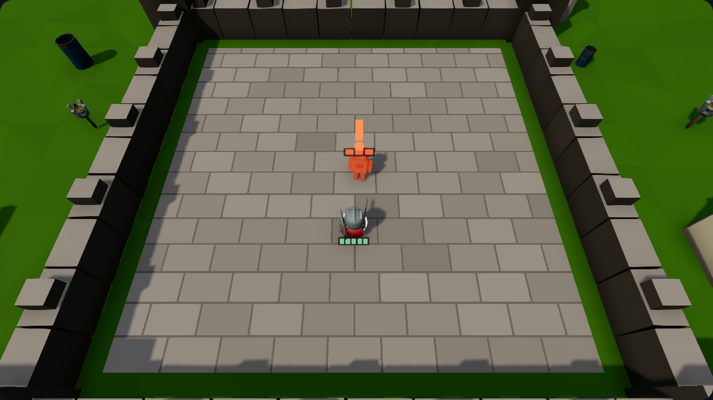
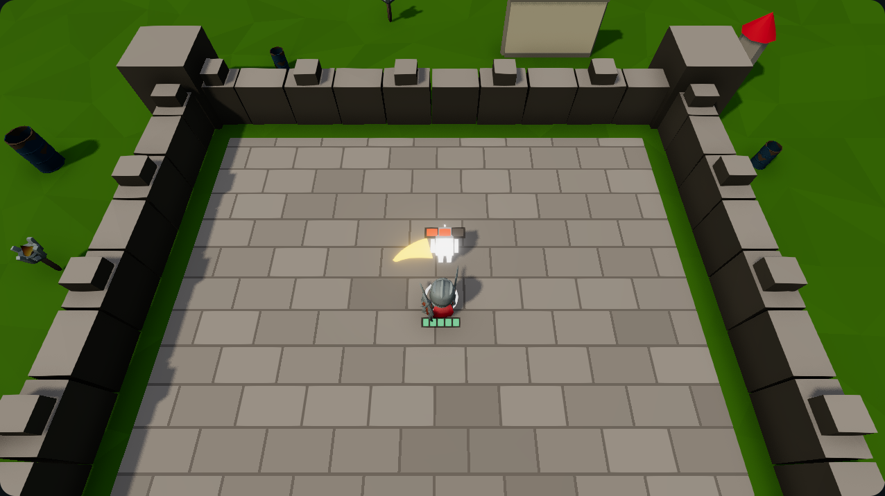
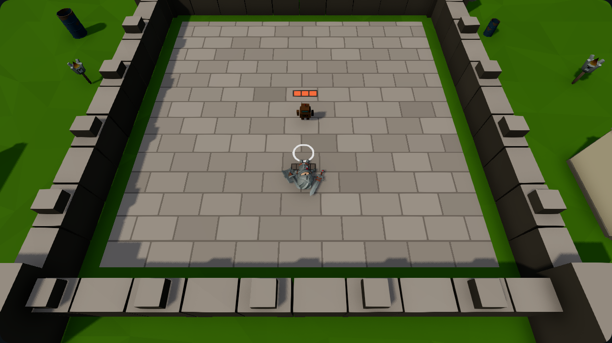
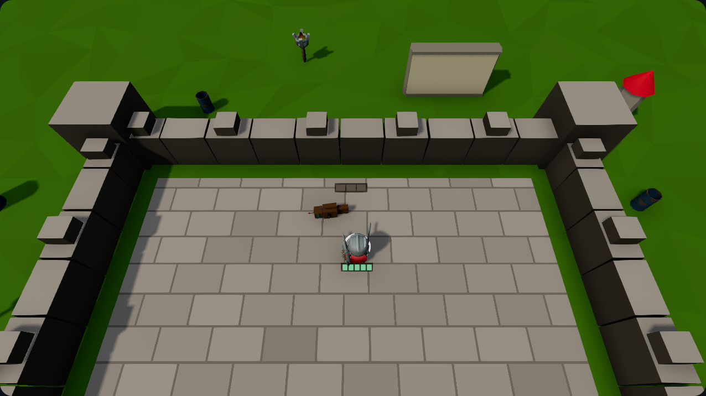
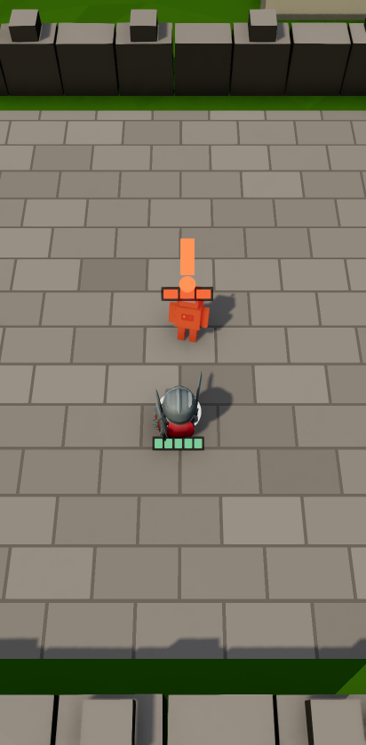
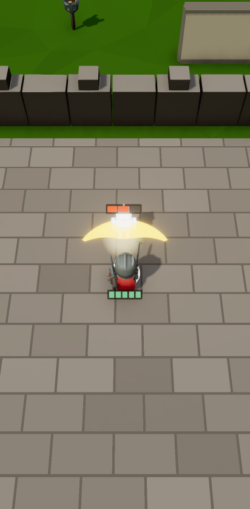
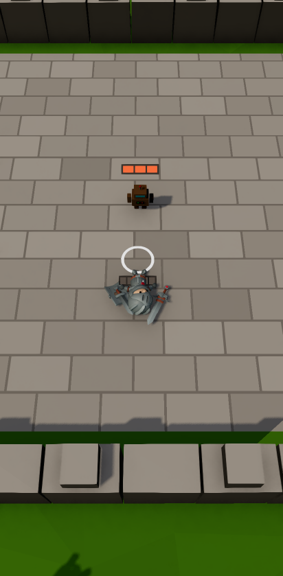
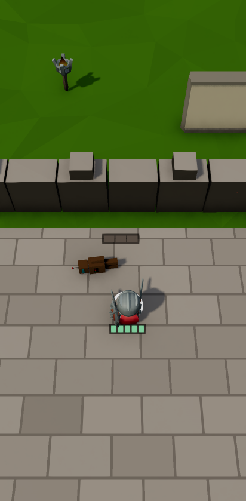

# Kočka a lední medvěd – aréna ve stylu B (P32E T5)

Věta „A cat collects glowing fish on a frozen lake while a polar bear chases it“
(rychlá verze: `arenaGenre.draftFill` bez modelu → `compileGenre`), na desktopu
(1280×720) a na Pixel 7 (412×839, CPU 4× pomalejší). Na snímku je jen plátno hry, bez HUD.

- `start` – tik 30, medvědi ještě spí za zády kočky.
- `wake` – tik 105, ochrana dobíhá: nad medvědy svítí vykřičník.
- `chase` – půlka běhu robota, medvěd honí.
- `win` – robot dohraje „rukou“ k výhře.

Start, probuzení a honičku hraje ukázka robota („Show me how“), výhru robot „rukou“.

```
FALLBACK_SMOKE_URL=http://127.0.0.1:3355 node scripts/p32/heavy.mjs -- npx playwright test e2e/p32-arena.spec.ts
```

## Měření 30. 9.

| Snímek | Hrdina (výška obrazu) | Medvěd v záběru (střed, NDC) | Vykřičníky |
|---|---|---|---|
| desktop start | 10,4 % | ano (0,27; −0,21) | 0 |
| desktop wake | 11,8 % | ano (0,26; 0,13) | 2 |
| desktop chase | 6,9 % | ano (−0,03; −0,81) | 0 |
| Pixel 7 start | 8,7 % | ano (0,76; −0,16) | 0 |
| Pixel 7 wake | 10,9 % | ano (0,78; 0,13) | 2 |
| Pixel 7 chase | 6,9 % | ano (−0,12; −0,81) | 0 |

FPS Pixel 7 se 4× CPU: medián 41 (úroveň `low`). Fialová na žádném snímku.

**Známá vada mimo arénu:** „glowing fish“ katalog přeložil na akvárium (štítek `fish`),
takže věci jsou zářící skleněné kvádry, ne ryby. Výběr modelu je ve sdíleném
`models.ts` – požadavek je v plánu P32E pod „Findings routed by the run“.

## Souboj rytířů (P32E T6)

Věta „Two knights duel in a castle“ (rychlá verze; hrdinu, kterého slovník věty
nenajde, doplní přijímací sada), stejná zařízení. Na každém snímku jsou lišty HP
(soupeř nad hlavou, hrdina u nohou na straně kamery) a kamera souboje je strmější
(60° místo 50°), ať soupeř za hrdinou nezmizí.

- `telegraph` – hráč stojí, soupeř 18 tiků z 30 chystá úder: záklon, vzepětí, červeň a vykřičník.
- `hit` – hra člověka klávesnicí, první zásah: žlutý srpek švihu, bílý záblesk zasaženého, částice sběrnice, hit-stop 60 ms jen v kresbě.
- `lose` – hráč dojde k soupeři a stojí; riggovaný rytíř padne klipem `die`.
- `ko` – robot „rukou“ dohraje k výhře, soupeř leží na boku (procedurální pád, klip `die` nemá).

Čtečka dostane HP jako `role="meter"`: „Knight health 5 of 5“, „Rival robot health 0 of 3“.

| Snímek | Hrdina (výška obrazu) | Soupeř (střed, NDC) | Sonda scény |
|---|---|---|---|
| desktop telegraph | 12,9 % | ano (0,01; 0,24) | vykřičník 1, rudne 1 |
| desktop hit | 18,5 % | ano (0,01; 0,02) | bliká 1, švih 1, klip hrdiny `shoot` |
| desktop lose | 16,1 % | ano (0,00; 0,38) | leží 1, klip hrdiny `die` |
| desktop ko | 13,7 % | ano (−0,05; −0,03) | leží 1 |
| Pixel 7 telegraph | 11,6 % | ano (0,02; 0,21) | vykřičník 1, rudne 1 |
| Pixel 7 hit | 15,7 % | ano (−0,01; 0,13) | bliká 1, švih 1, klip hrdiny `shoot` |
| Pixel 7 lose | 14,6 % | ano (−0,01; 0,35) | leží 1, klip hrdiny `die` |
| Pixel 7 ko | 12,3 % | ano (−0,15; −0,02) | leží 1 |

FPS Pixel 7 se 4× CPU pod ukázkou rytířů: medián 32,5 (úroveň `low`), kočka ve
stejném běhu 51. Stroj vytěžovala jiná sezení a medián skákal mezi běhy: build
před T6 32,5 a 51, build s T6 42 a 15 – rozdíl dělá zátěž, ne efekty souboje.
Fialová na žádném snímku.

**Známá vada mimo arénu:** soupeř je robot, ne rytíř. `enemyModel` ve sdíleném
`models.ts` čte roli `enemy`, souboj ale jmenuje soupeře rolí `rival` a `move_free`
popisky rolí nečte, takže scéna dostane náhradní `robot`.

## Desktop 1280×720


## Pixel 7


## Rytíři, desktop 1280×720






## Rytíři, Pixel 7





