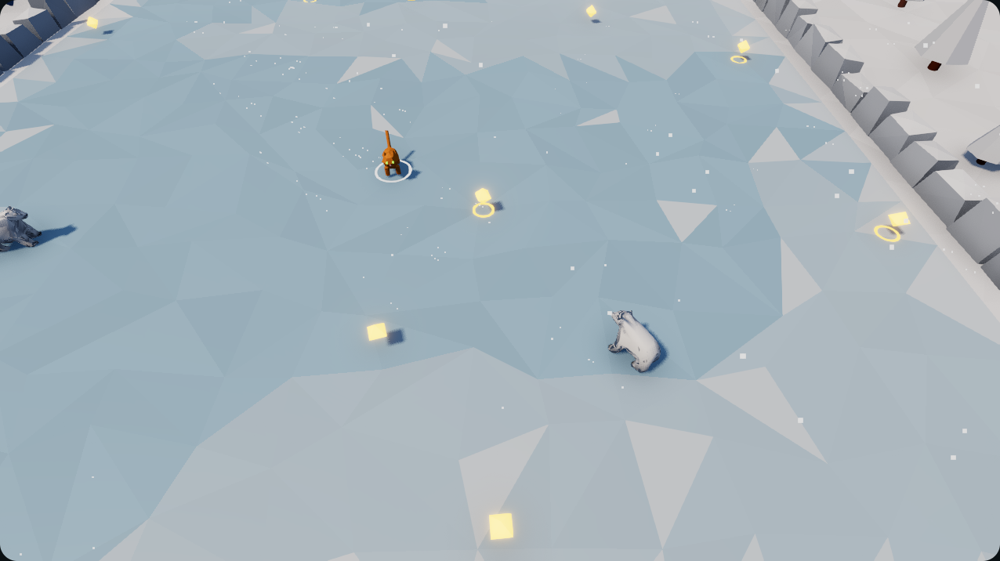
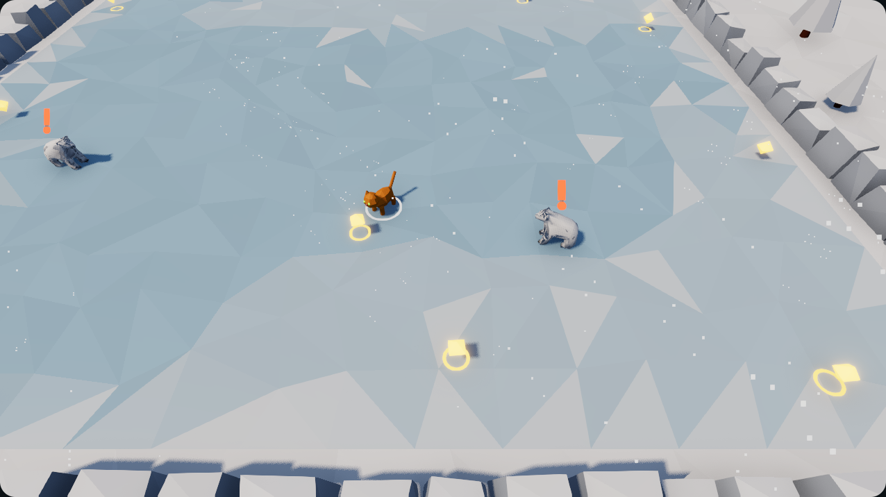
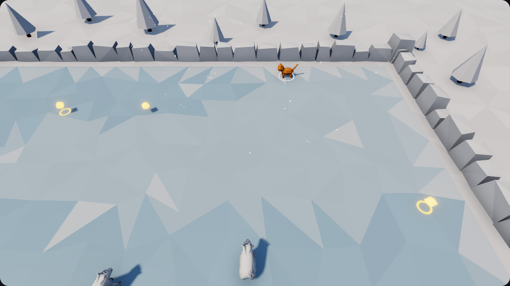
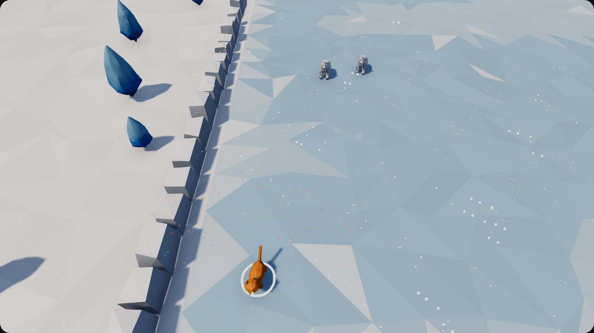
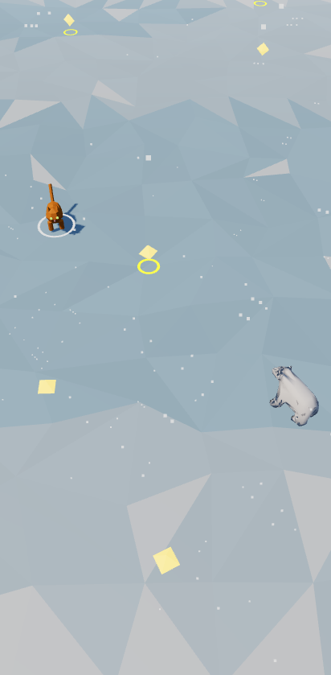
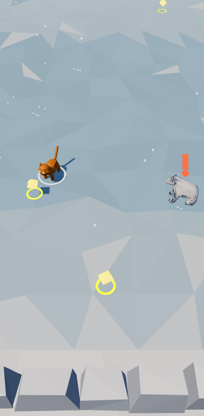
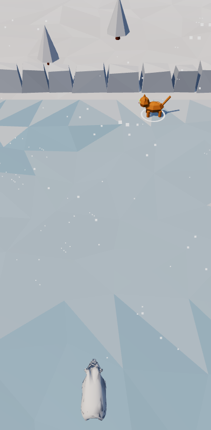
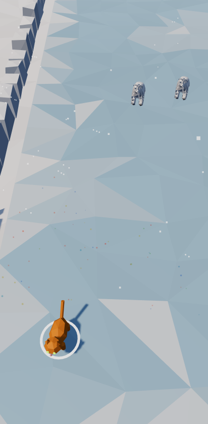

# Kočka a lední medvěd – aréna ve stylu B (P32E T5)

Věta „A cat collects glowing fish on a frozen lake while a polar bear chases it“
(rychlá verze: `arenaGenre.draftFill` bez modelu → `compileGenre`), na desktopu
(1280×720) a na Pixel 7 (412×839, CPU 4× pomalejší). Na snímku je jen plátno hry, bez HUD.

- `start` – tik 30, medvědi ještě spí za zády kočky.
- `wake` – tik 105, ochrana dobíhá: nad medvědy svítí vykřičník.
- `chase` – půlka běhu robota, medvěd honí.
- `win` – robot dohraje „rukou“ k výhře.

Start, probuzení a honičku hraje ukázka robota („Show me how“), výhru robot „rukou“.

```
FALLBACK_SMOKE_URL=http://127.0.0.1:3355 node scripts/p32/heavy.mjs -- npx playwright test e2e/p32-arena.spec.ts
```

## Měření 30. 9.

| Snímek | Hrdina (výška obrazu) | Medvěd v záběru (střed, NDC) | Vykřičníky |
|---|---|---|---|
| desktop start | 10,4 % | ano (0,27; −0,21) | 0 |
| desktop wake | 11,8 % | ano (0,26; 0,13) | 2 |
| desktop chase | 6,9 % | ano (−0,03; −0,81) | 0 |
| Pixel 7 start | 8,7 % | ano (0,76; −0,16) | 0 |
| Pixel 7 wake | 10,9 % | ano (0,78; 0,13) | 2 |
| Pixel 7 chase | 6,9 % | ano (−0,12; −0,81) | 0 |

FPS Pixel 7 se 4× CPU: medián 41 (úroveň `low`). Fialová na žádném snímku.

**Známá vada mimo arénu:** „glowing fish“ katalog přeložil na akvárium (štítek `fish`),
takže věci jsou zářící skleněné kvádry, ne ryby. Výběr modelu je ve sdíleném
`models.ts` – požadavek je v plánu P32E pod „Findings routed by the run“.

## Desktop 1280×720






## Pixel 7





