# Galerie hrdinů vět P32 (P32C T5)

Generuje `e2e/p32-heroes.spec.ts` – needitovat ručně. Hrdina a nepřítel každé z devíti vět `evals/play/p32/sentences.json` ve stojce a v běhu, ortografická kamera zepředu, osa `forward` z manifestu míří ke kameře. Běh bez klipu je poskok jako `proceduralPose` v `RiggedModel.tsx`.

- **Úroveň:** `identity` = model, který větu jmenuje; `near` = blízká identita; `class` = zástupce třídy; `fallback` = výchozí model role (`heroChoice` v `src/play/arcade/models.ts`).
- **Klipy:** jméno klipu v GLB, `–` = pohyb dopočítá kód.
- **Země:** rozdíl spodní hrany siluety a země ve stojce (limit 3 px). **Čelem:** sonda natočení – o kolik hlava a špičky vyčnívají ke kameře v poměru k hloubce modelu; kladná = čelem; jen se zapisuje, rytíři čelem dala −0,46, natočení soudí oko. **Výška:** podíl výšky snímku ve stojce / v běhu (limit 20 %).
- Kuchař a žralok zatím nemají animovaný model: `evals/play/p32/kits-missing.md`.

| Věta | Role | Model | Úroveň | Zdroj | Klipy | Země | Čelem | Výška | Snímky |
|---|---|---|---|---|---|---|---|---|---|
| penguin | hrdina | `rigged:pet-penguin` | identity | Kenney, CC0-1.0 – Kenney Cube Pets – https://kenney.nl/media/pages/assets/cube-pets/44e58e945f-1774520254/kenney_cube-pets_1.0.zip#Models/GLB format/animal-penguin.glb | idle `idle`, run `run`, jump –, hit –, die – | 0.1 px | 0.12 | 61 % / 57 % | 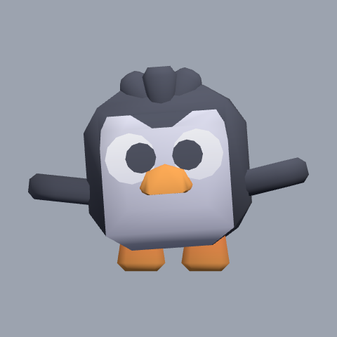 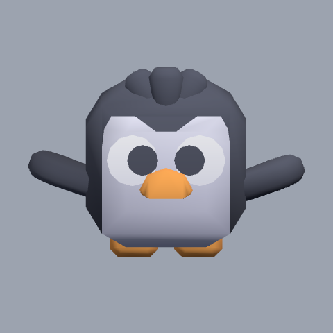 |
| firefighter robot | hrdina | `rigged:blocky-robot` | identity | Kenney, CC0-1.0 – Kenney Blocky Characters – https://kenney.nl/media/pages/assets/blocky-characters/8369c0cf30-1749547469/kenney_blocky-characters_20.zip#Models/GLB format/character-g.glb | idle `idle`, run `sprint`, jump –, hit –, die `die` | 0.0 px | 0.24 | 83 % / 75 % | 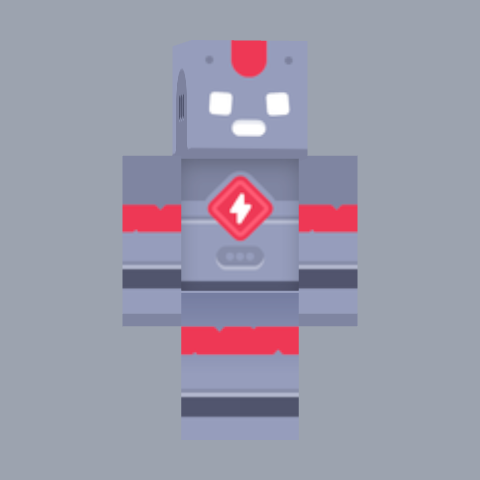 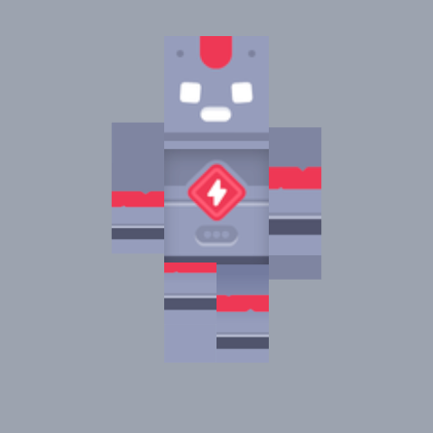 |
| wizard | hrdina | `rigged:mage` | identity | Kay Lousberg, CC0-1.0 – KayKit Character Pack: Adventurers 1.0 – https://raw.githubusercontent.com/KayKit-Game-Assets/KayKit-Character-Pack-Adventures-1.0/main/addons/kaykit_character_pack_adventures/Characters/gltf/Mage.glb | idle `Idle`, run `Running_A`, jump `Jump_Idle`, hit `Hit_A`, die `Death_A` | 0.2 px | -0.08 | 83 % / 80 % | 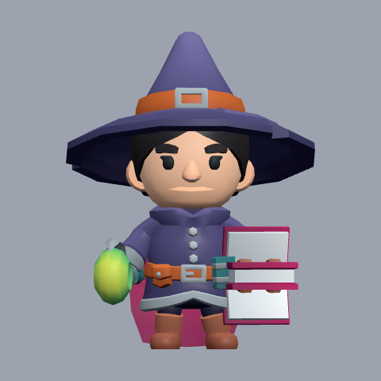 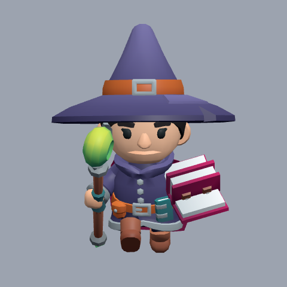 |
| pirate ship | hrdina | `gen3d-pirate-ship` | identity | Worldsmith project – generated by ops/gen3d, LicenseRef-Worldsmith-Generated – ops/gen3d; scripts/assets/gen3d/promote.mjs | idle –, run –, jump –, hit –, die – | 0.0 px | 0.03 | 83 % / 80 % | 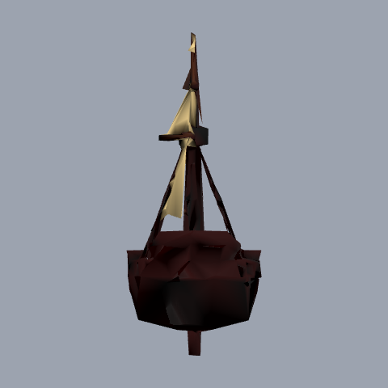 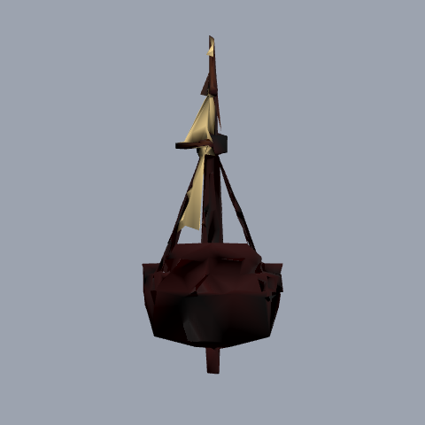 |
| cat | hrdina | `rigged:pet-cat` | identity | Kenney, CC0-1.0 – Kenney Cube Pets – https://kenney.nl/media/pages/assets/cube-pets/44e58e945f-1774520254/kenney_cube-pets_1.0.zip#Models/GLB format/animal-cat.glb | idle `idle`, run `run`, jump –, hit –, die – | 0.0 px | 0.08 | 83 % / 80 % | 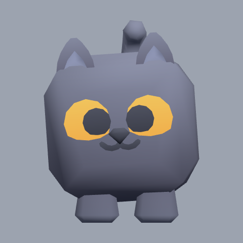 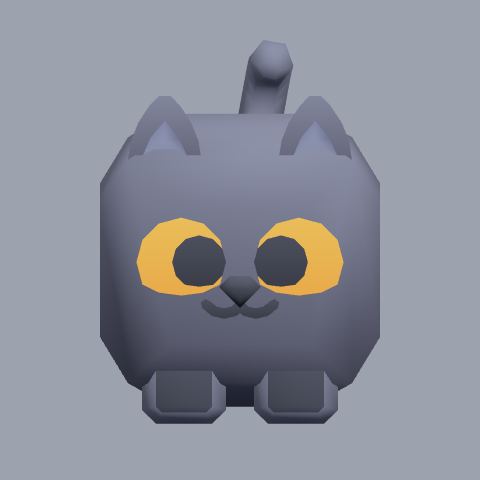 |
| chef | hrdina | `waiter` | identity | Worldsmith project — AI-assisted original geometry (Blender), LicenseRef-Worldsmith-Original – scripts/assets/blender/game_models.py; scripts/assets/game-models.mjs | idle –, run –, jump –, hit –, die – | 0.0 px | 0.03 | 83 % / 80 % | 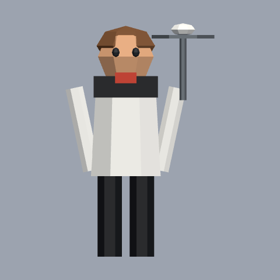 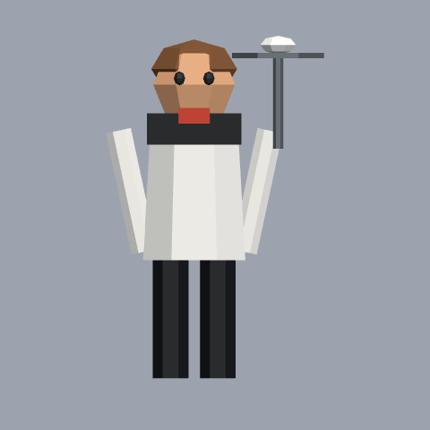 |
| dog | hrdina | `rigged:pet-dog` | identity | Kenney, CC0-1.0 – Kenney Cube Pets – https://kenney.nl/media/pages/assets/cube-pets/44e58e945f-1774520254/kenney_cube-pets_1.0.zip#Models/GLB format/animal-dog.glb | idle `idle`, run `run`, jump –, hit –, die – | 0.0 px | 0.07 | 83 % / 79 % | 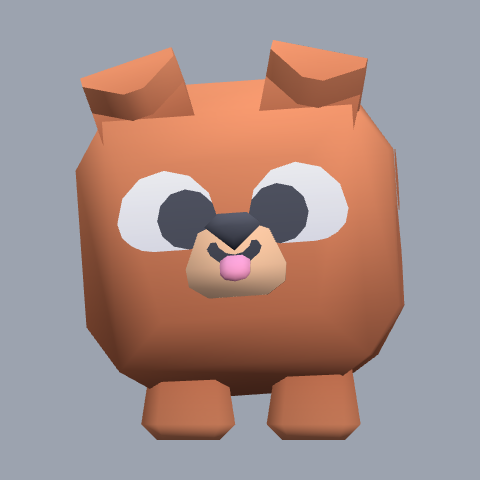 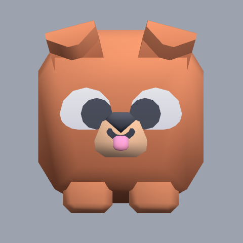 |
| knight | hrdina | `rigged:knight` | identity | Kay Lousberg, CC0-1.0 – KayKit Character Pack: Adventurers 1.0 – https://raw.githubusercontent.com/KayKit-Game-Assets/KayKit-Character-Pack-Adventures-1.0/main/addons/kaykit_character_pack_adventures/Characters/gltf/Knight.glb | idle `Idle`, run `Running_A`, jump `Jump_Idle`, hit `Hit_A`, die `Death_A` | 0.2 px | -0.46 | 83 % / 80 % | 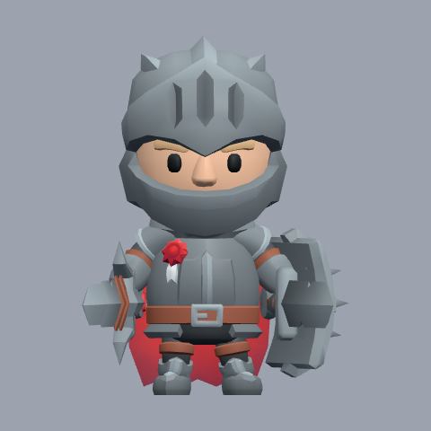 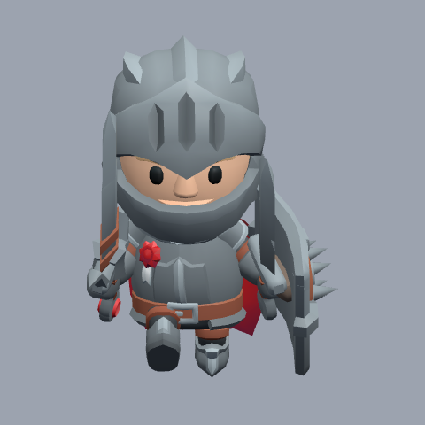 |
| rocket | hrdina | `rocket` | identity | Worldsmith project — AI-assisted original geometry (Blender), LicenseRef-Worldsmith-Original – scripts/assets/blender/game_models.py; scripts/assets/game-models.mjs | idle –, run –, jump –, hit –, die – | 0.0 px | 0.30 | 83 % / 79 % |   |
| ghost | nepřítel | `rigged:graveyard-ghost` | identity | Kenney, CC0-1.0 – Kenney Graveyard Kit – https://kenney.nl/media/pages/assets/graveyard-kit/ba8d4b4517-1760691807/kenney_graveyard-kit_5.0.zip#Models/GLB format/character-ghost.glb | idle `idle`, run `sprint`, jump `jump`, hit –, die `die` | 5.4 px | 0.07 | 75 % / 79 % | 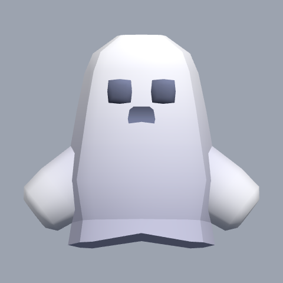 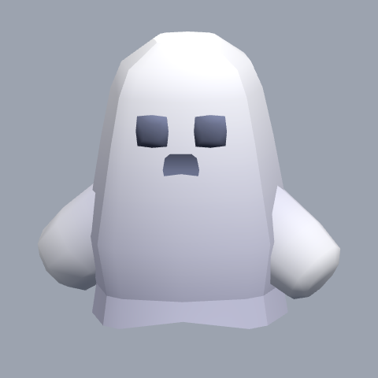 |
| polar bear | nepřítel | `rigged:pet-polar-bear` | identity | Kenney, CC0-1.0 – Kenney Cube Pets – https://kenney.nl/media/pages/assets/cube-pets/44e58e945f-1774520254/kenney_cube-pets_1.0.zip#Models/GLB format/animal-polar.glb | idle `idle`, run `run`, jump –, hit –, die – | 0.0 px | 0.01 | 83 % / 79 % | 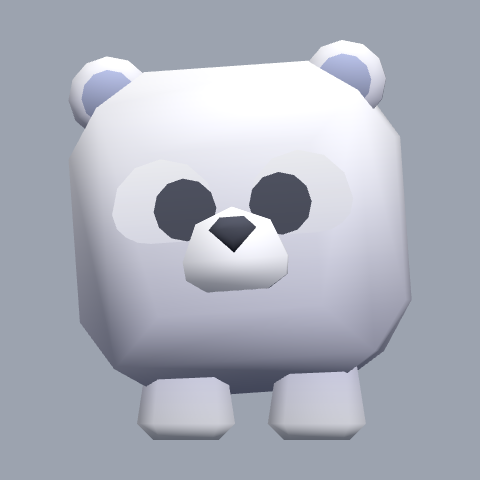 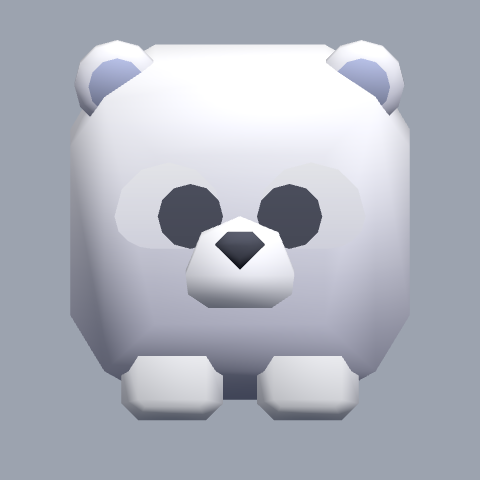 |
| shark | nepřítel | `cc0-shark` | identity | Quaternius (quaternius.com), CC0-1.0 – https://quaternius.com/packs/cutefish.html | idle –, run –, jump –, hit –, die – | 1.0 px | -0.05 | 83 % / 79 % | 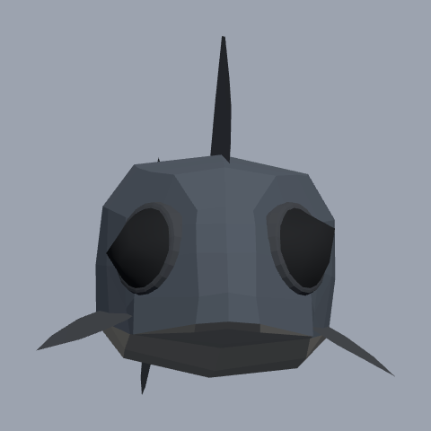 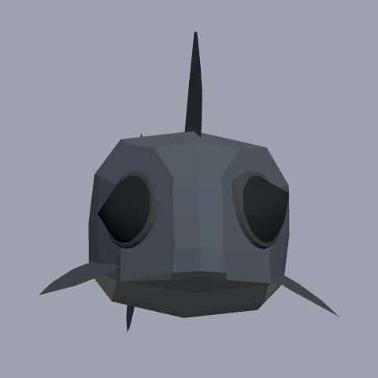 |
