# Tučňák – referenční řez vedle ukázky B (P32A T8)

Věta „A penguin slides down an icy mountain, collects snowflakes and avoids rocks“
ve dvou verzích, každá na desktopu (1280×720) a na Pixel 7 (412×839, CPU 4× pomalejší):
snímek na startu, uprostřed běhu a po výhře. Na snímku je jen plátno hry, bez HUD.

- **Rychlá verze** (`quick-*`): věta → `runnerGenre.draftFill` bez modelu → `compileGenre`.
  Dokud stopa B nepřepojí návrh ze slov na žánry, skládá ji test sám.
- **AI verze** (`ai-*`): fixtura `src/play/genre/__fixtures__/penguin.json` → `compileGenre`.
- Obě dávají tutéž hru (tučňák, kámen, vločka, sada `snow`); liší se jen délkou trati
  (výhra v tiku 1522 proti 1339) a rozmístěním překážek.

Start a střed běhu hraje ukázka robota („Show me how“, bez částic), výhru dohraje
robot „rukou“, aby sběrnice vydala konfety.

```
FALLBACK_SMOKE_URL=http://127.0.0.1:3351 node scripts/p32/heavy.mjs -- npx playwright test e2e/p32-penguin.spec.ts --project=chromium
```

## Ukázka B – cíl

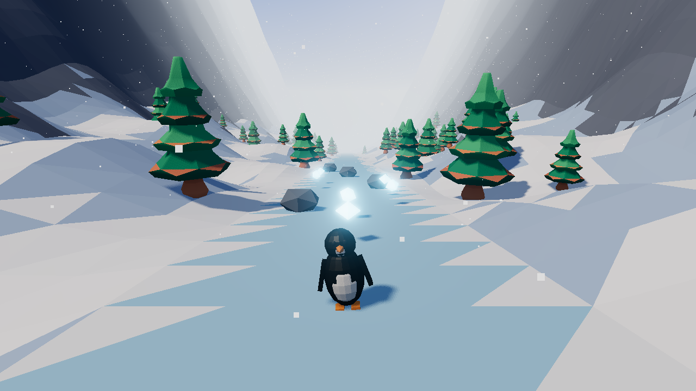

## Desktop 1280×720

| snímek | na co se dívat |
|---|---|
|  | Údolí se zubatou ledovou dráhou sedí na B; tučňák zezadu s modrým stínem vpravo. Místo zelených smrků bílé kužely a modré ledové krystaly. |
| 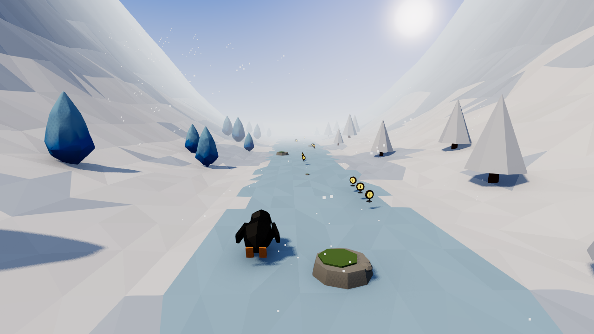 | Kámen vedle tučňáka má zelený mech a „vločky“ jsou žluté mince na stojánku – v B šedé balvany a svítící vločky. |
| 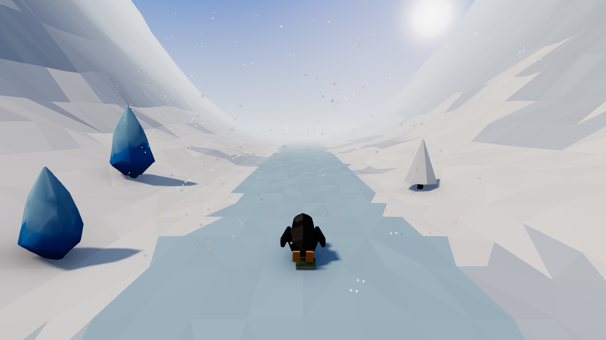 | Tučňák na cílové značce; konfety jsou jen drobné barevné tečky po celé scéně, výhra z obrazu skoro nepoznáte. |
| 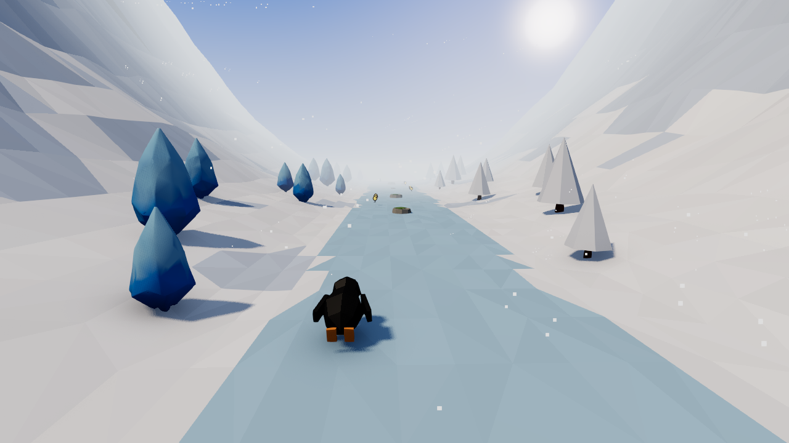 | Stejný záběr jako rychlá verze – obě verze vypadají stejně. |
| 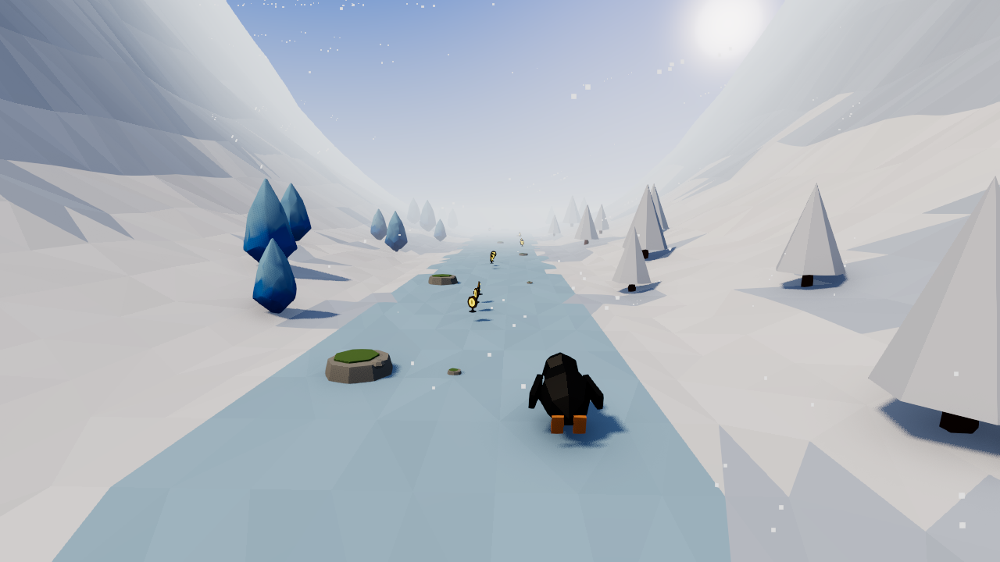 | Tučňák v pravém pruhu zakryje většinu vlastního stínu; vpředu kameny s mechem a mince. |
| 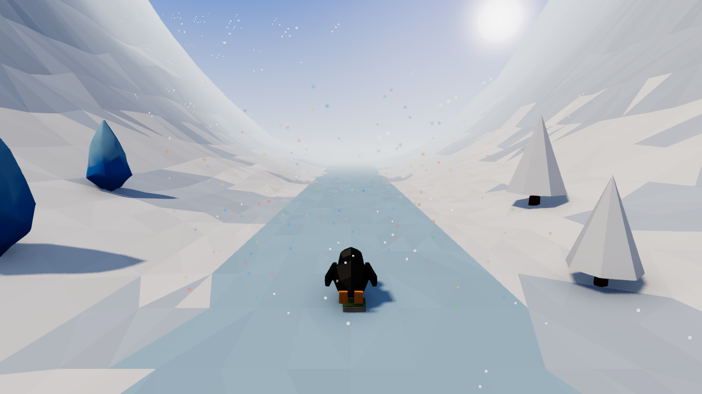 | Totéž jako výhra rychlé verze: značka cíle a slabé konfety. |

## Pixel 7, CPU 4× pomalejší

| snímek | na co se dívat |
|---|---|
| 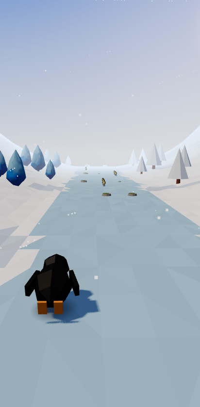 | Na výšku: horní dvě pětiny je prázdná obloha, stěny údolí skoro nejsou vidět. Úroveň kvality `low` (bez AO a bloomu), stín pořád kreslí. |
| 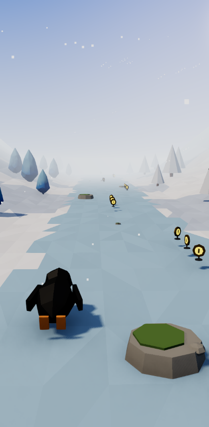 | Kámen s mechem vpravo dole je největší věc v záběru; stíny kamene, mincí i tučňáka jsou vidět. |
| 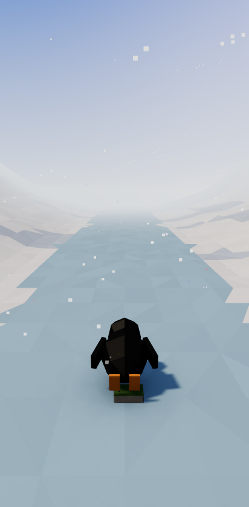 | Tučňák v cíli, konfety na telefonu prakticky nejsou vidět. |
| 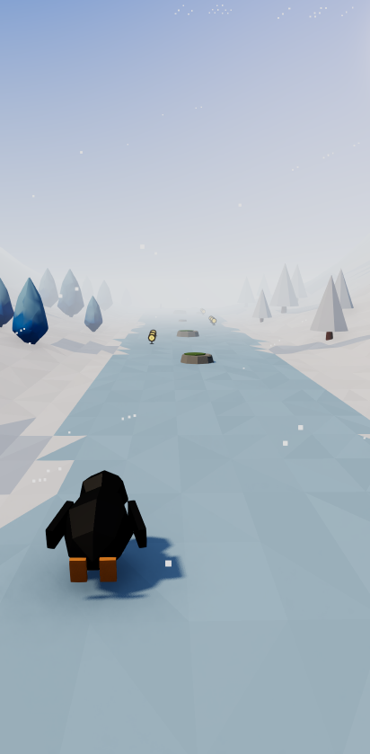 | Stejný záběr jako rychlá verze, úroveň `medium`. |
| 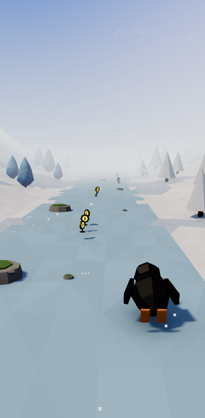 | Dráha před tučňákem skoro prázdná, kulisy splývají s mlhou. |
| 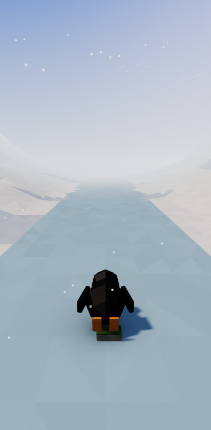 | Jako výhra rychlé verze. |

## Naměřeno 30. 9. 2026

| | rychlá, desktop | AI, desktop | rychlá, Pixel 7 | AI, Pixel 7 |
|---|---|---|---|---|
| výhra | ano | ano | ano | ano |
| medián FPS (20 s ukázky) | – | – | 44,0 | 46,2 |
| stín u hrdiny: start / střed / výhra | 10,5 / 9,9 / 7,2 % | 10,5 / 2,9 / 7,1 % | 11,0 / 10,6 / 7,7 % | 10,7 / 5,6 / 7,7 % |
| fialová (všechny snímky) | 0,0 % | 0,0 % | 0,0 % | 0,0 % |

- **Stín u hrdiny** = podíl pixelů v pásu vpravo od těla (slunce sady svítí zleva zezadu),
  které jsou zřetelně tmavší než osvětlená země a modré. Kontaktní skvrna pod tučňákem
  do pásu nezasáhne, takže číslo měří jen stín slunce. Test hlídá > 3 % na startu;
  uprostřed běhu záleží na pruhu (AI verze v pravém pruhu 2,9 %).
- **Fialová** = odstín 250–320° se sytostí aspoň 25 %; test hlídá pod 0,1 % na každém snímku.

## Co se od B liší (odhad z pohledu na snímky, ne měření)

- **Stromy:** B má zelené smrky se sněhem na patrech, tady jsou smrky celé bílé (čepička sněhu
  pokryje celý kužel) a vedle nich sytě modré ledové krystaly, které v B nejsou.
- **Překážky a vločky:** kámen je plochý se zeleným mechem, sbírané „vločky“ jsou žluté mince.
  B má šedé balvany a bílé svítící vločky. Model pro vločku ani zasněžený kámen řez nemá.
- **Stěny údolí:** B má tmavé skalní stěny, tady jsou svahy celé bílé a celkový obraz je světlejší
  a plošší. Obloha má kotouč slunce vpravo nahoře, B zamlžený světlý konec údolí.
- **Tučňák:** kamera je za ním, takže je vidět černá záda a nohy; že leží na břiše, z tohoto
  úhlu nepoznáte. B ho ukazuje zepředu (bílé bříško, zobák). Póza jízdy přichází z modelu
  ptáka, ne ze slovesa věty (spec větu nenese, požadavek T5-R1).
- **Sedí:** tvar údolí, zubatý kraj ledové dráhy, modré stíny, padající sníh, mlha v dálce.
  Bloom bílý sníh nerozmazal (otázka z „Co nevíme“ plánu).
