# P70D – slepý soud před/po a FPS telefonu

Měřeno 2026-11-04T18:58:46.258Z. Soud: `codex exec -i` nad `sheet.png` v prázdném dočasném adresáři, strana snímku „po“ ze semínka (`afterSideOf`). FPS: Pixel 7, CPU 4×, mediány prokládaných běhů (baseline `0d3fa930` proti `main` po T2–T4).

**Brána:** „po“ vyhrálo 6 z 8 (cíl ≥ 6) · FPS bez poklesu přes 5 % · **PROŠLO**

| Scéna | Soud | FPS před | FPS po | Změna |
|---|---|---|---|---|
| runner-forest | after | 42.3 | 44.6 | 5.4 % |
| runner-snow | after | 46.9 | 45.3 | -3.4 % |
| arena | after | 38.9 | 39.2 | 0.8 % |
| platformer-beach | after | 52.9 | 50.7 | -4.2 % |
| minigolf | after | 55.4 | 56.3 | 1.6 % |
| railfps | before | 57.8 | 55.2 | -4.5 % |
| catch | after | 58.3 | 56.1 | -3.8 % |
| defense | before | 45.7 | 44.5 | -2.6 % |

**Poznámky k měření** (vzorky a nahrazené řádky v `after/fps*.json`, pole `superseded`):
- První prokládaný běh (4 opakování) se u arény, pláže a golfu zasekl na ~0 FPS na obou stranách (zátěž stroje souběžnými běhy P70A–C); tyto scény a sníh změřeny znovu, 6 opakování.
- Sníh s prachem T4 klesl dvakrát přes mez (−10 %, −6,2 %). Levnější varianta: sada `snow` bez prachu, jen ptáci (prach na bílém sněhu nebyl vidět). Pokus 1: −3,4 %, snímky „po“ sněhu přefocené s touto variantou.
- Prohry soudu: railfps (krystal v popředí zakryl značku) a defense (rozložení vln) – odhad: rozdíl daný okamžikem záběru, ne vzhledem P70D.

## Snímky (3. vteřina): před | po

### runner-forest

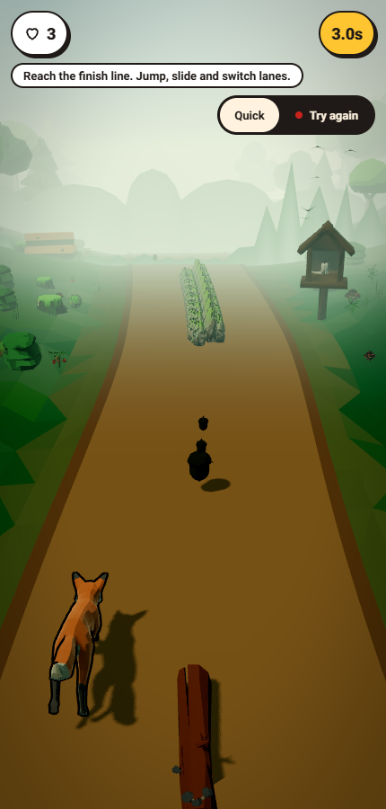 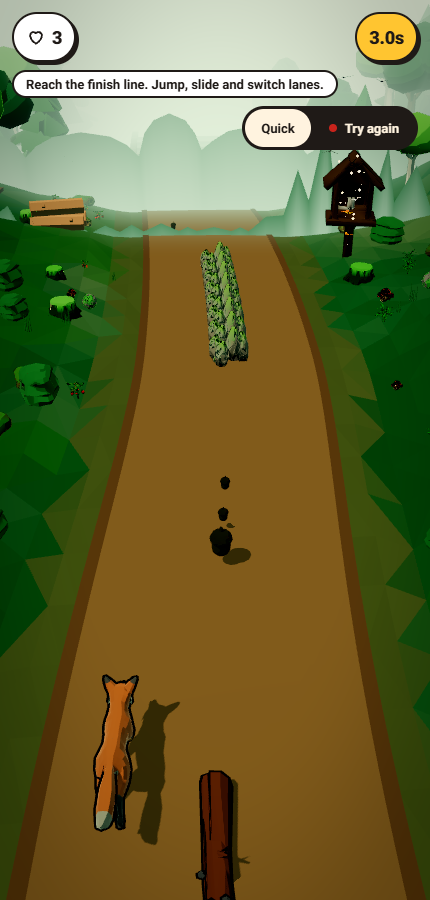

### runner-snow

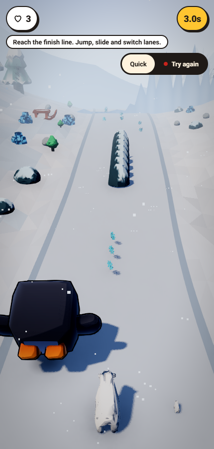 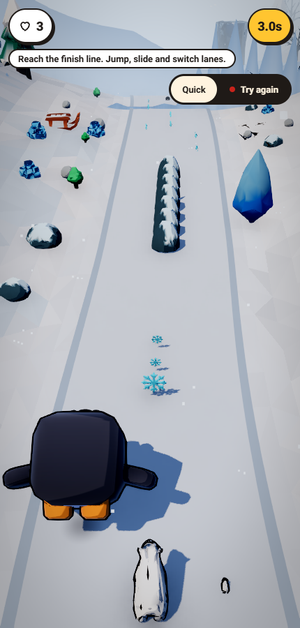

### arena

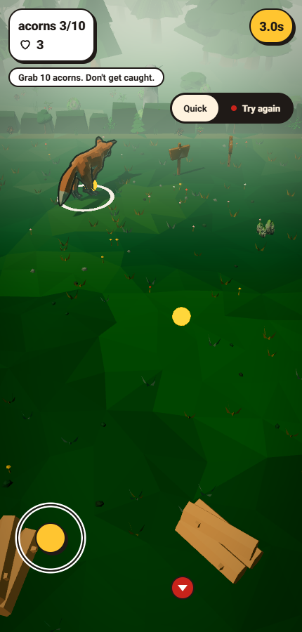 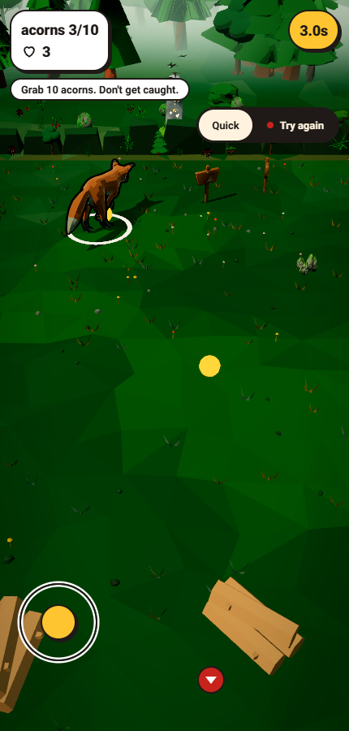

### platformer-beach

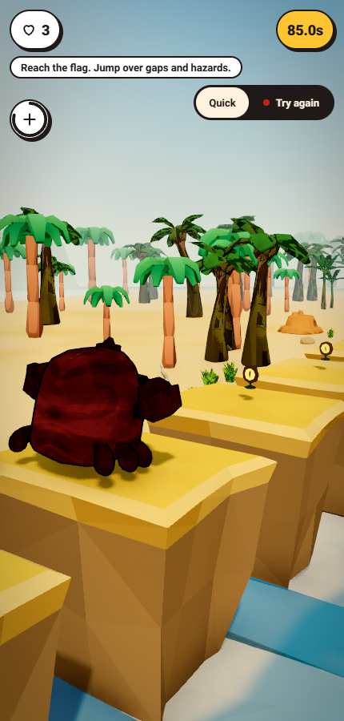 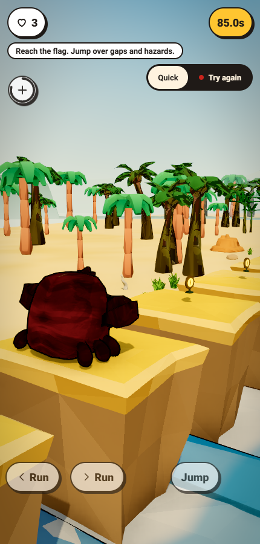

### minigolf

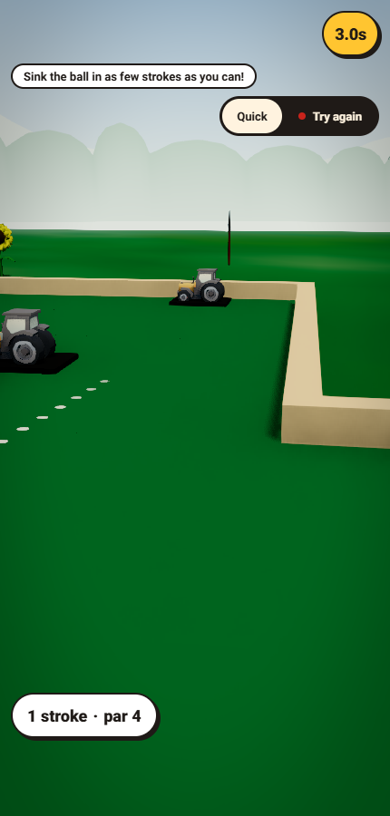 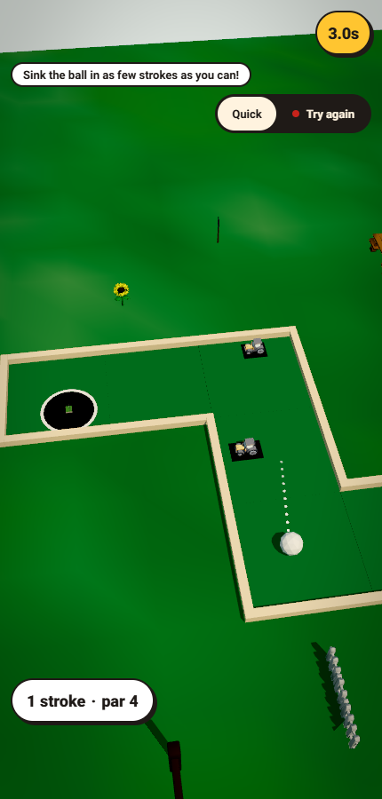

### railfps

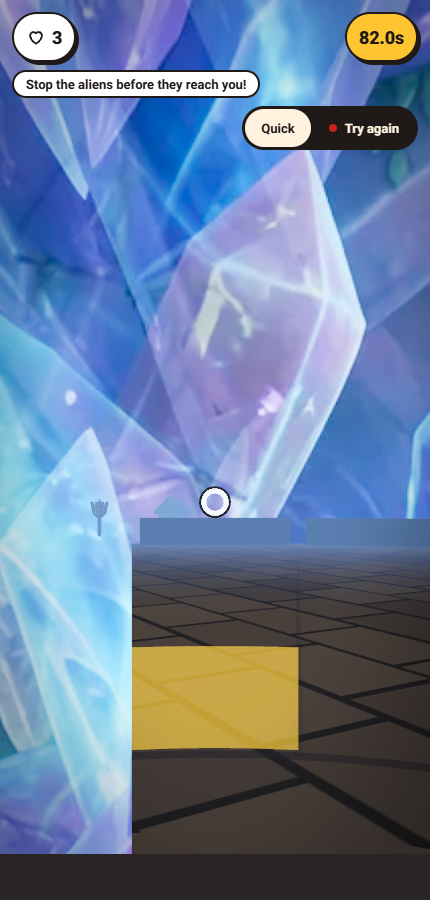 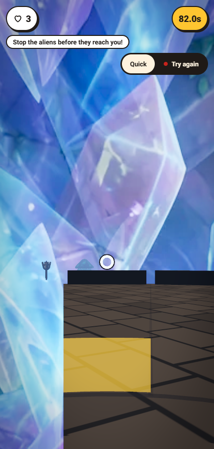

### catch

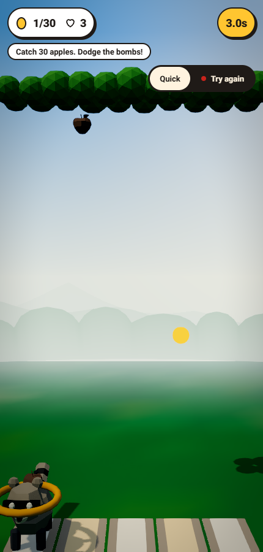 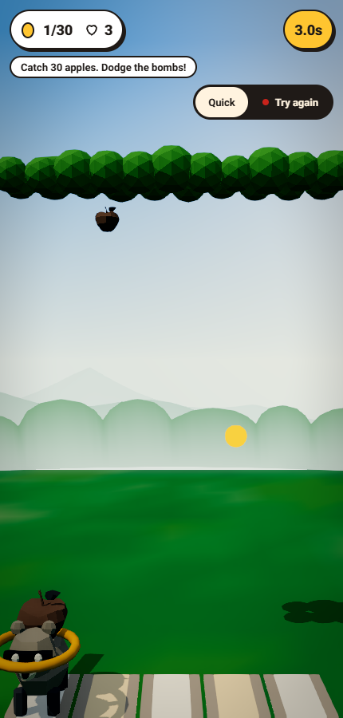

### defense

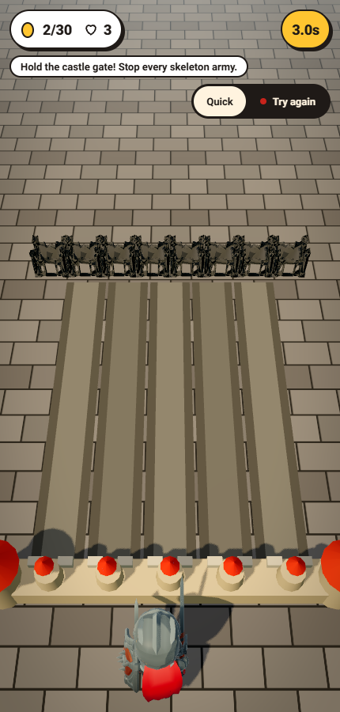 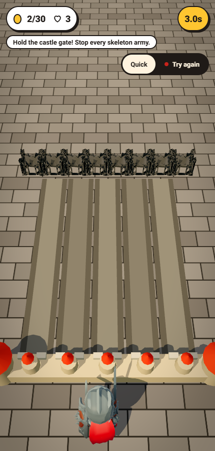

