# Po T8b – konečný stav větve

Nafoceno 2026-11-06 19:31 skriptem `scripts/play/p73d-shots.mjs`. Snímky `<věta>-<desktop|phone>-<0start|1play|2play>.jpg`: start, 3. a 8. s ukázky robota na ručních hodinách. Kamera v 3. s: sklon pod vodorovnou (°), obzor a hrdina jako NDC y (+1 horní hrana, −1 dolní).

| # | věta | žánr | ovládání | sada | pohled | kvalita | sklon | obzor | hrdina |
|---|---|---|---|---|---|---|---|---|---|
| s1 | Escape a volcano before the lava reaches you | runner | runner | volcano | desktop | high | 23,622 | 0,757 | -0,348 |
| s1 | Escape a volcano before the lava reaches you | runner | runner | volcano | phone | medium | 28,527 | 0,941 | -0,564 |
| s2 | An underwater race between a turtle and a shark | – | steer | underwater | desktop | high | 22 | 0,7 | -0,365 |
| s2 | An underwater race between a turtle and a shark | – | steer | underwater | phone | high | 24,905 | 0,804 | -0,506 |
| s3 | A cat delivering pizzas across rooftops while avoiding seagulls | arena | move_free | city | desktop | high | 25 | 0,808 | 0,209 |
| s3 | A cat delivering pizzas across rooftops while avoiding seagulls | arena | move_free | city | phone | high | 25 | 0,808 | -0,473 |
| s4 | Balance a tower of pancakes on a windy day | timing | timing | castle | desktop | high | 24 | 0,771 | 0,044 |
| s4 | Balance a tower of pancakes on a windy day | timing | timing | castle | phone | high | 24 | 0,771 | -0,142 |
| s5 | A knight jumps across floating islands to rescue a dragon egg | platformer | platform | beach | desktop | high | 0 | 0 | -0,011 |
| s5 | A knight jumps across floating islands to rescue a dragon egg | platformer | platform | beach | phone | high | 10 | 0,305 | -0,167 |
| s6 | A spaceship shoots asteroids in deep space | shooter | shooter | space | desktop | high | 10,045 | 0,398 | -0,667 |
| s6 | A spaceship shoots asteroids in deep space | shooter | shooter | space | phone | high | 33,69 | 1,155 | -0,71 |
| s7 | Play mini golf in a candy land | minigolf | minigolf | meadow | desktop | high | 24,624 | 0,794 | -0,146 |
| s7 | Play mini golf in a candy land | minigolf | minigolf | meadow | phone | medium | 24,624 | 0,794 | -0,364 |
| s8 | Find the lost crown in an old castle | quest | move_free | castle | desktop | high | 25 | 0,808 | 0,311 |
| s8 | Find the lost crown in an old castle | quest | move_free | castle | phone | medium | 25 | 0,808 | 0,012 |
| s9 | A bird flies through a stormy city | – | glide | city | desktop | high | 22,38 | 0,713 | -0,371 |
| s9 | A bird flies through a stormy city | – | glide | city | phone | high | 22,036 | 0,701 | -0,636 |
| s10 | A farmer catches falling apples in the orchard | catch | lanes | meadow | desktop | high | 23 | 0,735 | -0,554 |
| s10 | A farmer catches falling apples in the orchard | catch | lanes | meadow | phone | high | 23 | 0,735 | -0,373 |
| s11 | A dog races a cat through a candy land | – | steer | meadow | desktop | high | 22 | 0,7 | -0,323 |
| s11 | A dog races a cat through a candy land | – | steer | meadow | phone | high | 24,905 | 0,804 | -0,498 |
| s12 | A penguin slides down an icy mountain | runner | runner | snow | desktop | high | 23,909 | 0,768 | -0,266 |
| s12 | A penguin slides down an icy mountain | runner | runner | snow | phone | high | 28,811 | 0,953 | -0,442 |

## T7: šest nejslabších scén, před a po

Před = T1 na `main` 0dc32f8e, po = T2–T7 (snímky přefocené v T9 z buildu po T8b; desktop se od T7 nezměnil, telefon na startu `medium` je bez protisvětla). Desktop, 3. s ukázky robota. Cíl = koncept A v `../target/`.

| scéna | před | po | co se změnilo |
|---|---|---|---|
| s3 honička, město | 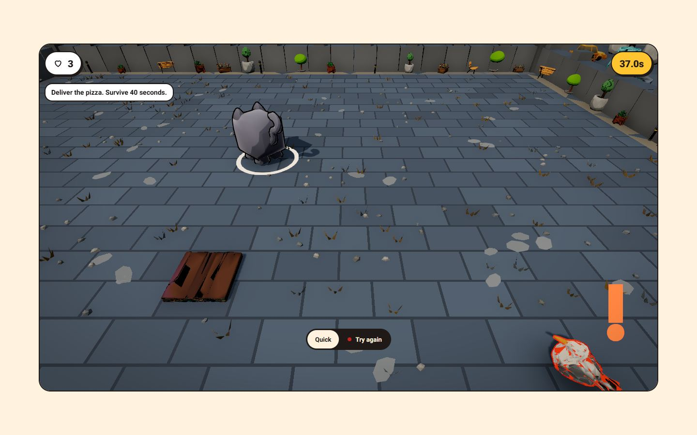 | 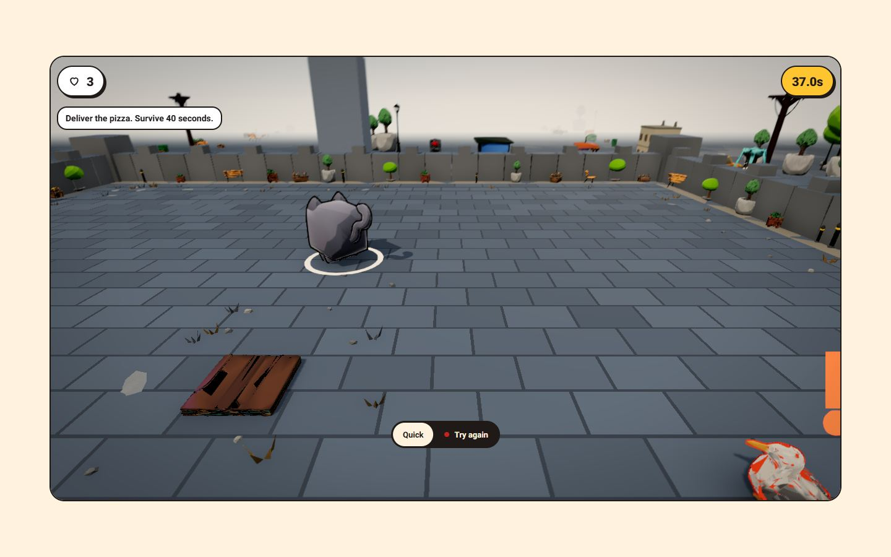 | Kamera arény drží 25° místo 35–40°, takže je vidět obzor se zídkou, stromy a domy a dlažba už nezabírá 70 % obrazu. |
| s8 quest, hrad | 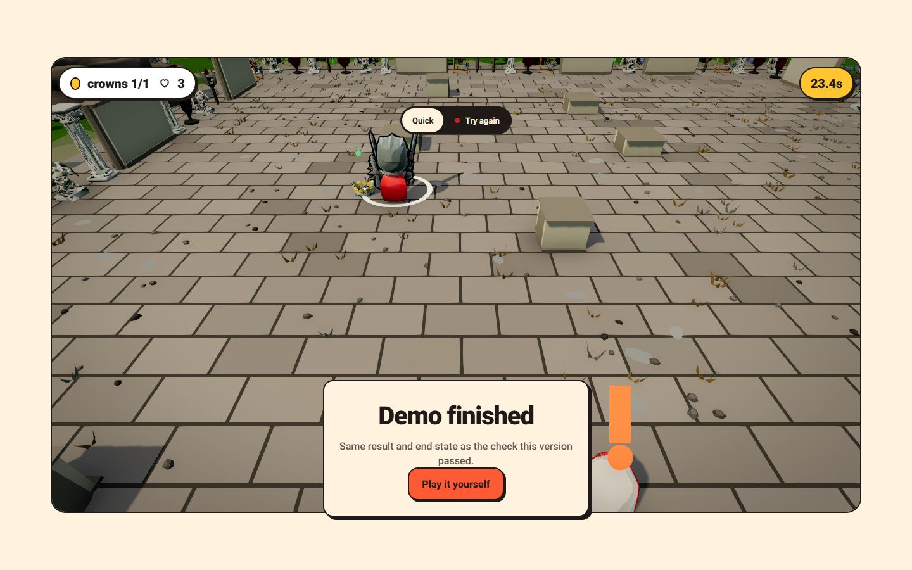 | 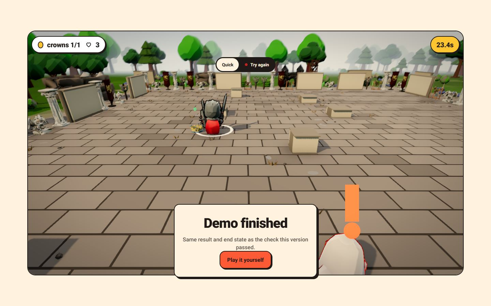 | Stejná kamera arény (25° místo 38–40°): za nádvořím je vidět les, sloupy a prapory, obzor leží v horní pětině. |
| s2 závod, podmoří | 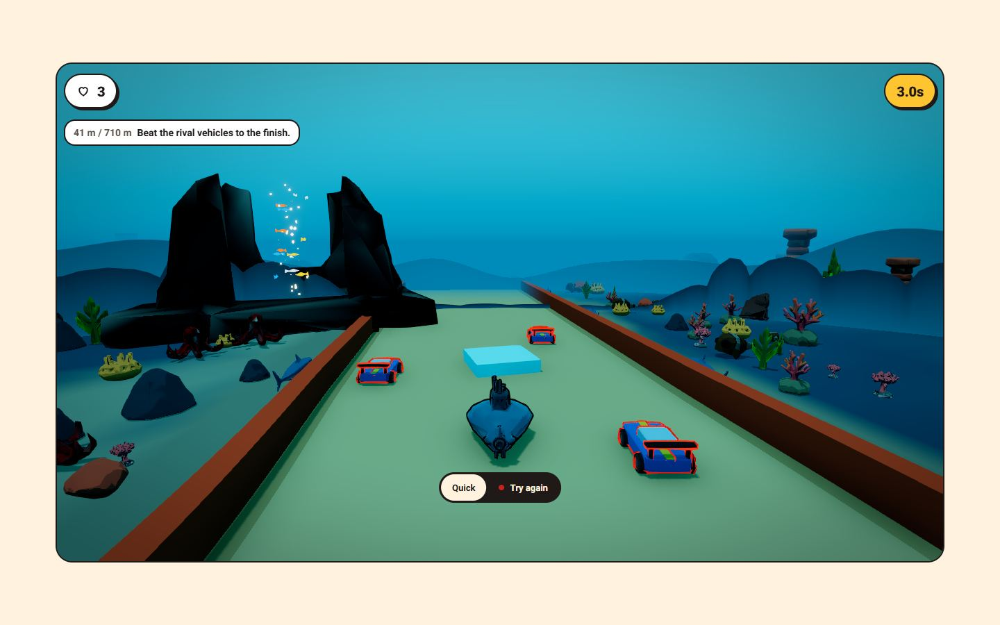 | 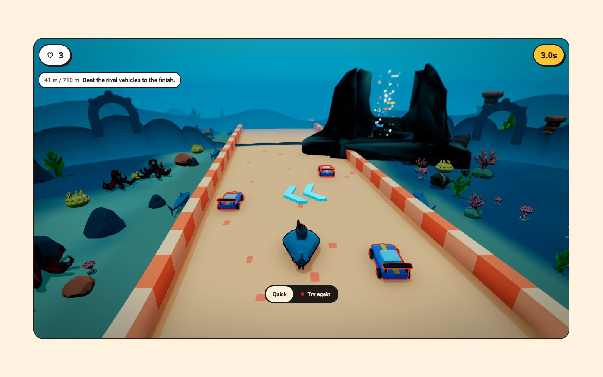 | Zelená deska je teď písková dráha (teplé vlastní světlo vyrovná modrozelenou vodu), mantinely bílo-korálové a místo azurových krychlí turbo šipky. |
| s4 stohování, hrad | 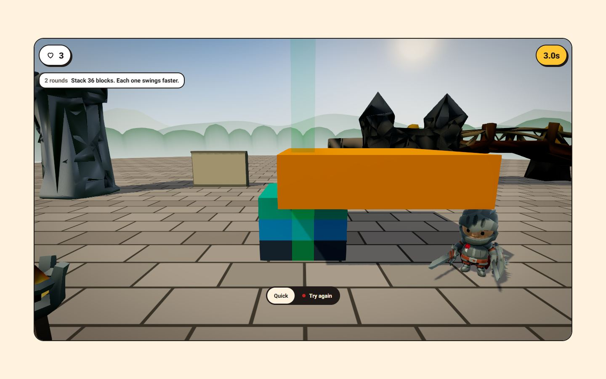 | 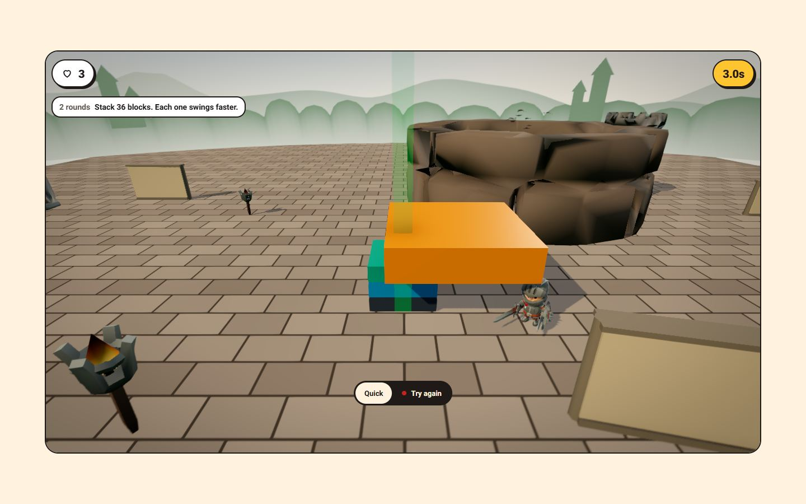 | Kamera o třetinu dál, deska zabírá ~25 % šířky místo půlky, rytíř není useknutý a černé střepy brány zmizely z osy za věží; zbývá velká hnědá studna vpravo za věží. |
| s7 golf, „candy land“ | 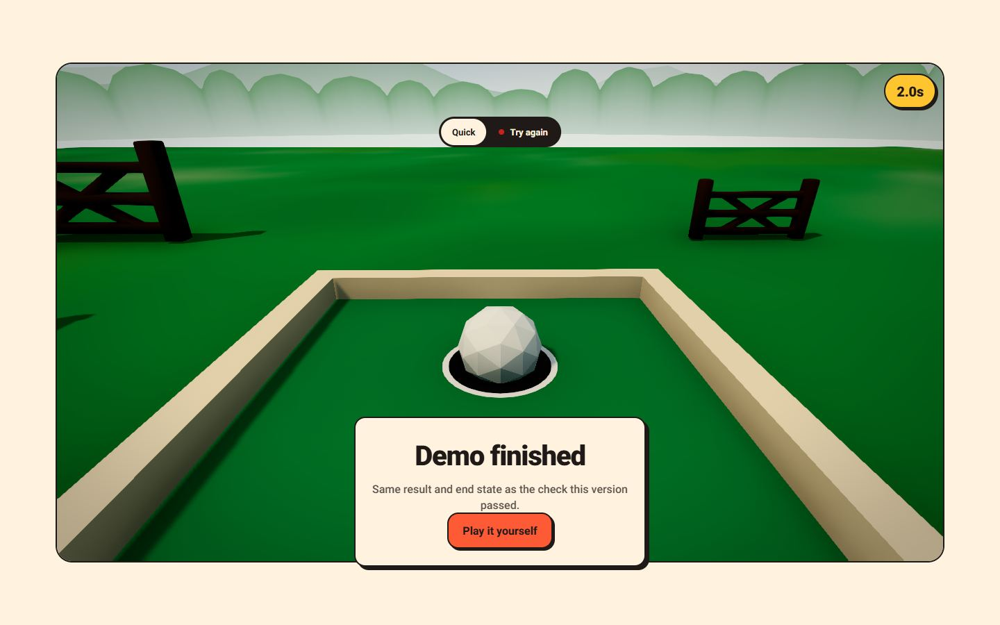 | 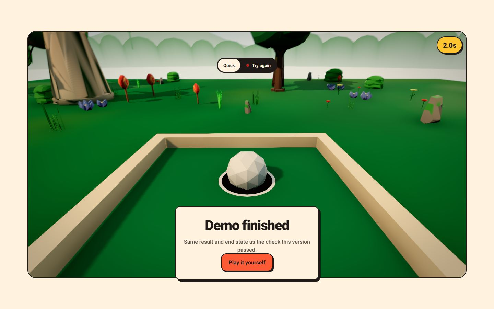 | Hřiště stojí na ostrově se stromy, keři, květinami a lízátky místo nekonečné zelené pláně v mlze. |
| s10 chytání, sad | 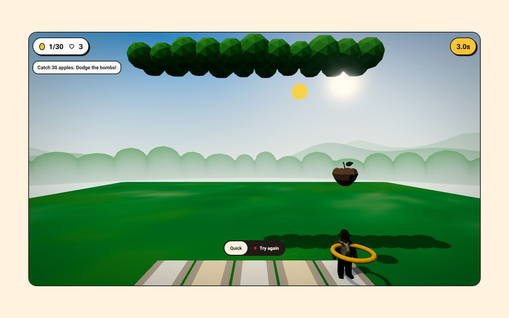 | 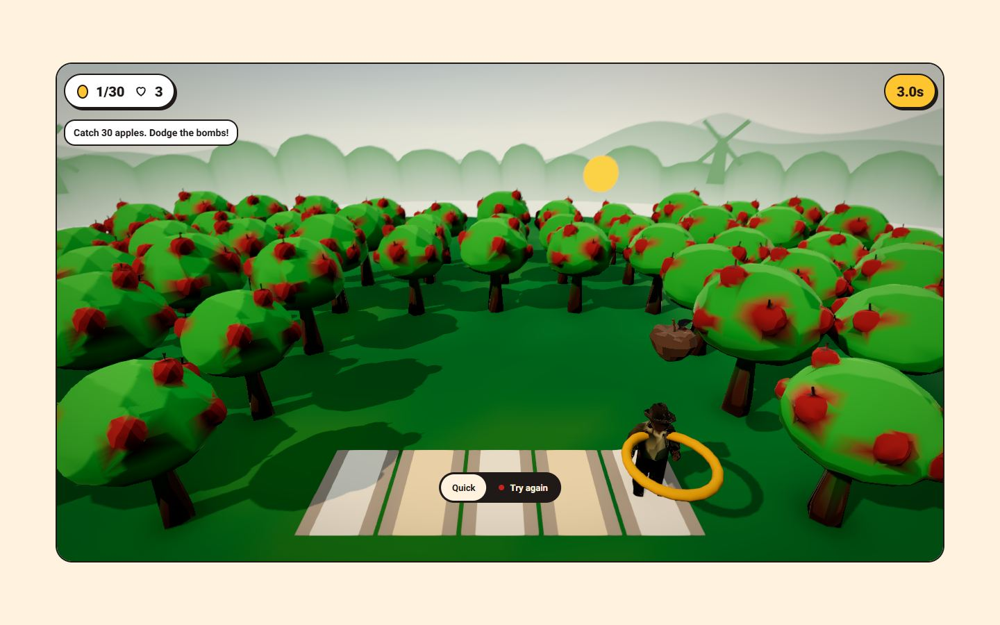 | Řada vznášejících se korun přes horní okraj je pryč; jabloně s kmeny stojí na zemi kolem pásu a za ním, obzor s mlýnem zůstal volný. |
