# P75 – cílové snímky (koncept A, hračkové diorama)

Každý cíl je náš snímek hry přemalovaný lokálně FLUX.2-klein-4B (ComfyUI, edit přes ReferenceLatent, 4 kroky, semínko 7, 1152×640 z výřezu 1264×704 na x 88, y 100 snímku 1440×900). Zadání: `Redraw this game scene as <co>. Style: <styl A>. <kamera>` – texty v `scripts/play/p75-restyle.mjs` (`SCENES`, `STYLE_A`). Licence a původ modelu FLUX: `disclosure.json` (`ops/env`, `LicenseRef-Worldsmith-Generated`).

| # | věta | cíl | zdroj snímku | vznik |
|---|---|---|---|---|
| s1 | Escape a volcano before the lava reaches you | 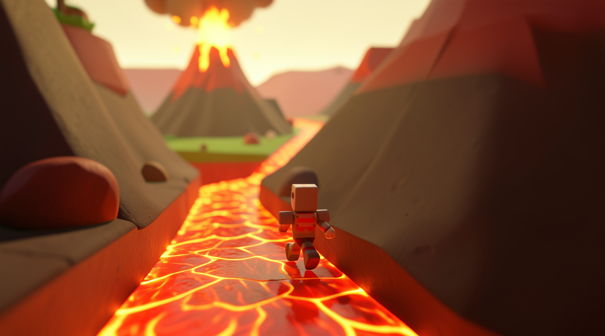 | P73D `s1-desktop-2play.png` (před T2–T8b) | koncept P73D `runner-A_diorama.png`, sezení 24a74f3a, 6. 11. |
| s2 | An underwater race between a turtle and a shark | 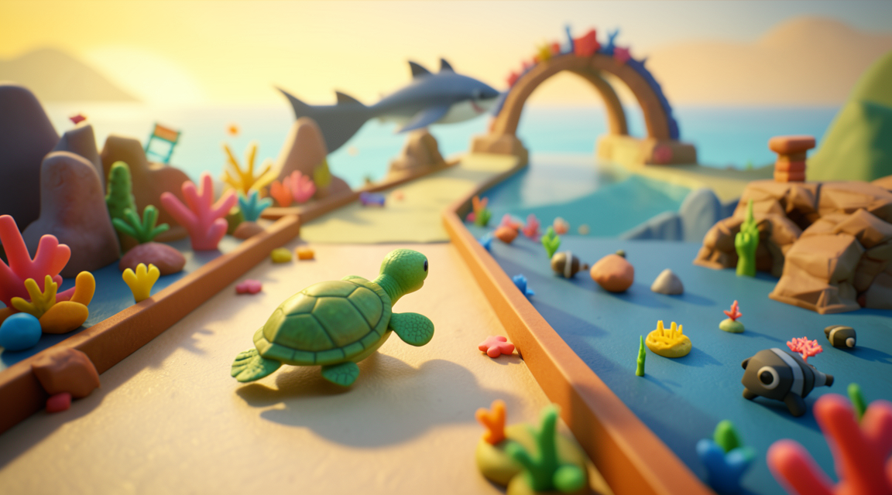 | P73D `s2-desktop-2play.png` | koncept P73D `race-A_diorama.png`, sezení 24a74f3a |
| s3 | A cat delivering pizzas across rooftops while avoiding seagulls | 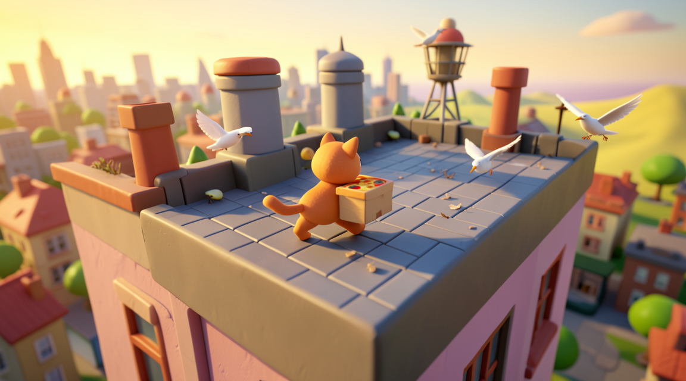 | P73D `s3-desktop-2play.png` | koncept P73D `chase-A_diorama.png`, sezení 24a74f3a |
| s4 | Balance a tower of pancakes on a windy day | 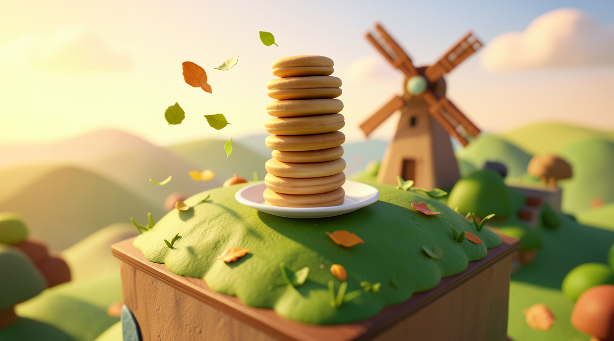 | P73D `s4-desktop-2play.png` | koncept P73D `stack-A_diorama.png`, sezení 24a74f3a |
| s5 | A knight jumps across floating islands to rescue a dragon egg | 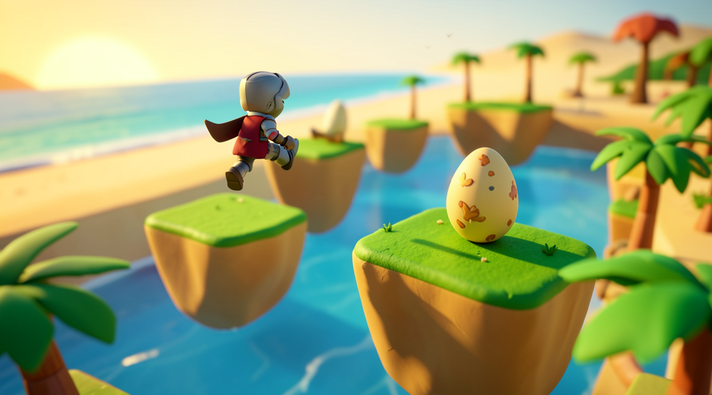 | `evals/play/p73/sceny/after/s5-desktop-1play.jpg` | `p75-restyle.mjs`, 7. 11. |
| s6 | A spaceship shoots asteroids in deep space | 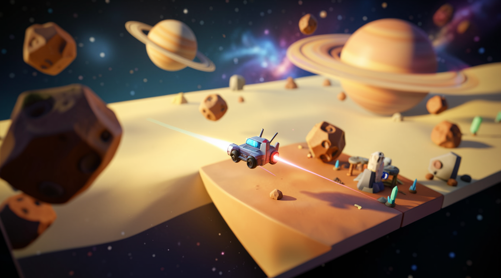 | `…/after/s6-desktop-1play.jpg` | `p75-restyle.mjs`, 7. 11. |
| s7 | Play mini golf in a candy land | 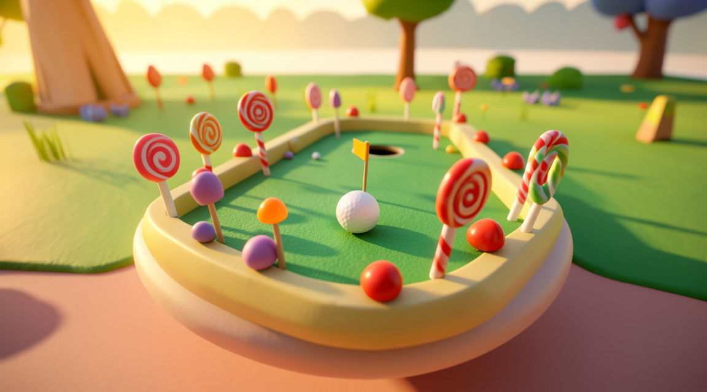 | `…/after/s7-desktop-1play.jpg` | `p75-restyle.mjs`, 7. 11. |
| s8 | Find the lost crown in an old castle | 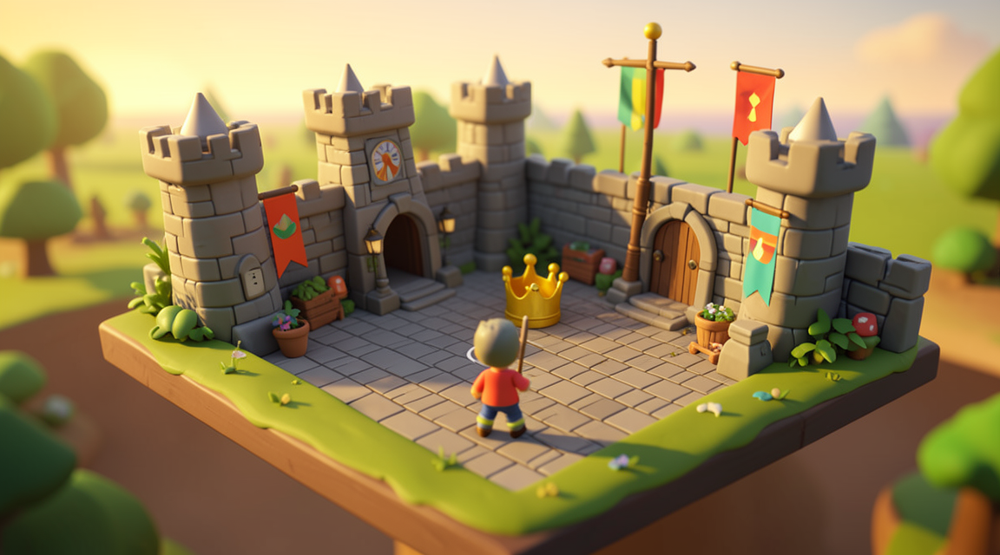 | `…/after/s8-desktop-1play.jpg` | `p75-restyle.mjs`, 7. 11. |
| s9 | A bird flies through a stormy city |  | `…/after/s9-desktop-1play.jpg` | `p75-restyle.mjs`, 7. 11. |
| s10 | A farmer catches falling apples in the orchard | 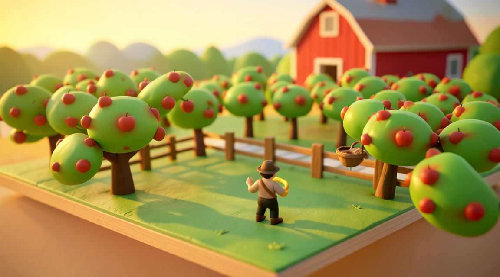 | `…/after/s10-desktop-1play.jpg` | `p75-restyle.mjs`, 7. 11. |
| s11 | A dog races a cat through a candy land | 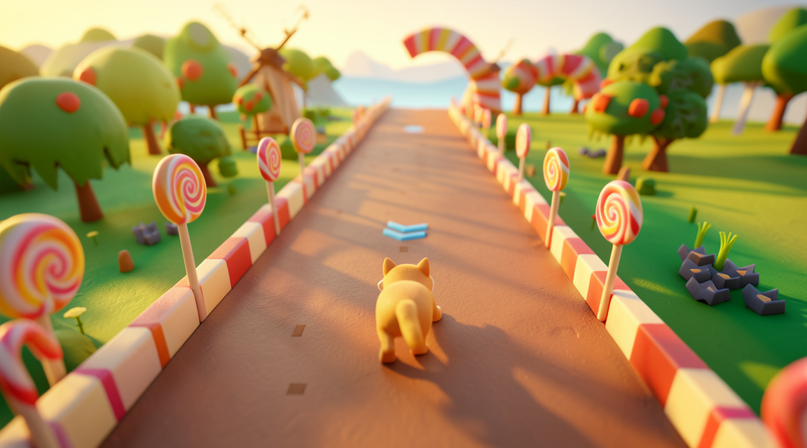 | `…/after/s11-desktop-1play.jpg` | `p75-restyle.mjs`, 7. 11. |
| s12 | A penguin slides down an icy mountain | 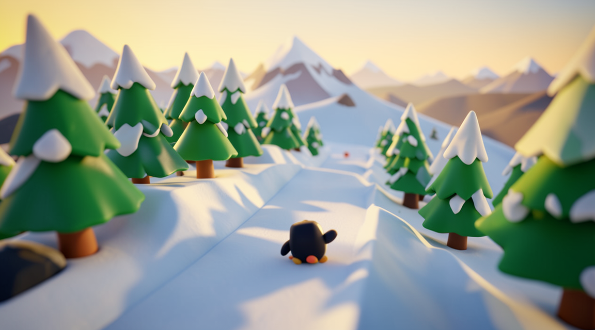 | `…/after/s12-desktop-1play.jpg` | `p75-restyle.mjs`, 7. 11. |

s1–s4 jsou koncepty, ze kterých P75 vychází (vybrané majitelem 7. 11.); vznikly ze snímků v 8. s, ne ve 3. s. Zbylých osm má stejné zadání stylu a kamery, jen jiné `<co>` podle věty.
